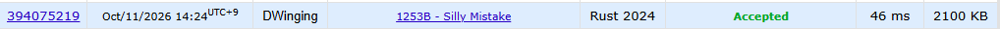

### Codeforces 1400 [1253B - Silly Mistake](https://codeforces.com/problemset/problem/1253/B) (Rust)

> **날짜:** 2026년 10월 11일  
> **알고리즘:** 그리디  
> **언어:** Rust  
> **핵심 키워드:** 그리디

## 📌 문제 개요

- 시간순으로 주어진 `n`개의 출입 기록에서 양수 `i`는 직원 `i`의 입장, 음수 `-i`는 퇴장을 뜻한다.
- 각 직원은 하루에 최대 한 번만 입장할 수 있다.
- 직원은 같은 날 입장하여 사무실 안에 있는 경우에만 퇴장할 수 있다.
- 매일 시작과 끝에는 사무실이 비어 있어야 한다.
- 기록 순서를 유지하여 비어 있지 않은 연속 구간으로 나눈 뒤, 유효한 날짜 수와 날짜별 기록 수를 출력한다. 가능한 분할이 없으면 `-1`을 출력한다.

---

## 💡 풀이 핵심 (Core Logic)

### 1. 날짜와 출입 상태를 하나의 배열에 저장

`solve`는 현재 날짜 `day`, 사무실 안의 인원 `cnt`, 해당 날짜의 기록 수 `event`를 관리한다. `visited[id]`가 `day`이면 현재 사무실 안에 있고, `-day`이면 오늘 이미 퇴장한 직원이다. 절댓값이 현재 날짜와 다르면 오늘 아직 입장하지 않은 직원으로 구분한다. 날짜를 상태값에 포함하므로 하루가 끝날 때마다 배열 전체를 초기화할 필요가 없다.

### 2. 입장과 퇴장 조건을 확인하며 인원 갱신

입장 기록에서는 `visited[id].abs() == day`이면 `-1`을 반환한다. 이미 안에 있는 직원의 중복 입장과 퇴장한 직원의 당일 재입장을 모두 막기 위해서다. 정상 입장이면 상태를 `day`로 바꾸고 `cnt`를 증가시킨다.

퇴장 기록에서는 `visited[id] == day`인 경우만 허용한다. 현재 사무실 안에 있는 직원인지 확인하여 입장 전 퇴장이나 중복 퇴장을 방지한다. 정상 퇴장이면 상태를 `-day`로 바꾸고 `cnt`를 감소시킨다.

### 3. 사무실이 비는 즉시 하루를 확정

유효한 기록을 처리할 때마다 `event`를 증가시키고, `cnt == 0`이 되면 `event`를 `result`에 저장한다. 이후 `day`를 증가시키고 `event`를 `0`으로 초기화한다. 사무실이 빈 시점에서는 하루를 끝내는 조건을 만족하며, 바로 다음 날로 나누면 이후 같은 직원이 다시 입장할 수 있다. 따라서 가능한 경계마다 즉시 분할하는 그리디 방식으로 기록을 처리한다.

모든 기록을 처리한 뒤에도 `cnt`가 남아 있으면 마지막 날을 정상적으로 끝낼 수 없으므로 `-1`을 반환한다. 그렇지 않으면 `result`의 길이를 날짜 수로, 각 원소를 날짜별 기록 수로 출력한다.

### 시간 복잡도

크기 `M`의 상태 배열을 초기화하고 `n`개의 기록을 한 번씩 확인하므로 시간 복잡도는 `O(M + n)`이다. 입력 배열, 상태 배열, 날짜별 기록 수와 출력 문자열을 포함한 공간 복잡도도 `O(M + n)`이다. 날짜가 바뀔 때는 배열을 다시 초기화하지 않는다.

- `n`: 출입 기록 수
- `M`: `visited` 배열의 크기 (`INF = 1_000_001`)

---

## 🧠 회고 및 결론

심플한 그리디 문제다.

---

### 📂 소스 코드

[main.rs](./main.rs)

---

### 🖥️ 실행 결과

---
