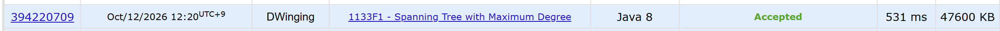

### Codeforces 1600 [1133F1 - Spanning Tree with Maximum Degree](https://codeforces.com/problemset/problem/1133/F1) (Java)

> **날짜:** 2026년 10월 12일  
> **알고리즘:** 그래프 탐색, 신장 트리  
> **언어:** Java  
> **핵심 키워드:** BFS, DFS, 최대 차수, 신장 트리

## 📌 문제 개요

- 연결된 단순 무방향 그래프의 정점 `n`개와 간선 `m`개가 주어진다.
- 입력에 있는 간선만 사용하여 모든 정점을 잇는 스패닝 트리를 만들어야 한다.
- 스패닝 트리에서 가장 큰 정점 차수가 가능한 한 커야 한다.
- 조건을 만족하는 스패닝 트리의 간선 `n-1`개를 출력한다.

---

## 💡 풀이 핵심 (Core Logic)

### 1. 인접 리스트를 만들고 최대 차수 정점을 선택

입력 간선을 양방향 인접 리스트에 저장한다. `searchMaxEdges`는 각 리스트의 크기를 비교하여 가장 많은 간선을 가진 정점을 `root`로 고른다. 스패닝 트리의 정점 차수는 원래 그래프의 차수를 넘을 수 없으므로, 이 정점의 모든 인접 간선을 포함시키는 것이 목표다.

### 2. 선택한 정점에서 BFS로 트리 간선을 구성

`solve`는 `root`를 방문 처리하고 배열 큐에 넣는다. 큐에서 정점을 꺼내 아직 방문하지 않은 이웃마다 방문 표시, 큐 삽입, 간선 출력 문자열 추가를 수행한다. 루트가 가장 먼저 처리되므로 루트의 인접 간선이 모두 선택된다. 이후의 간선은 새 정점을 기존 방문 집합에 하나씩 연결하여 순환 없이 모든 정점을 잇는다.

### 시간 복잡도

인접 리스트를 만들고 차수를 비교한 뒤 BFS에서 각 정점과 간선을 확인하므로 시간 복잡도는 `O(n + m)`이다. 인접 리스트, 방문 배열, 큐와 출력 문자열에 `O(n + m)` 공간을 사용한다.

- `n`: 정점 수
- `m`: 간선 수

---

## 🧠 회고 및 결론

1600점이라기엔 간단한 문제다. 최소 스패닝 트리가 아닌, 최대 차수를 갖는 스패닝 트리를 구성하는 문제였기 때문에 가장 많은 간선이 연결된 정점을 기준으로 BFS를 수행하면 쉽게 해결할 수 있었다.

---

### 📂 소스 코드

[Solution.java](./Solution.java)

---

### 🖥️ 실행 결과

---
