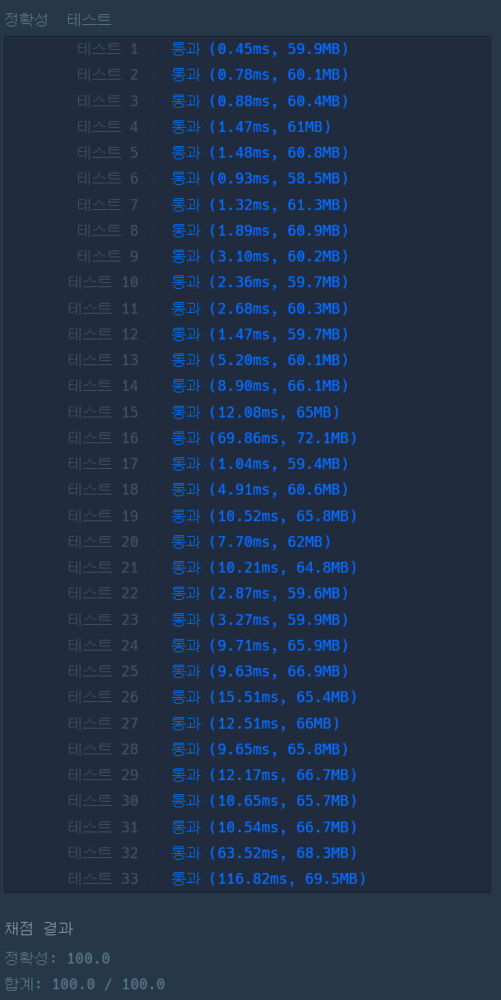

### 프로그래머스 Lv3 [발전소 회로 복구](https://school.programmers.co.kr/learn/courses/30/lessons/468375) (Kotlin)

> **날짜:** 2026년 10월 13일  
> **알고리즘:** 백트래킹, DP, BFS, 비트마스킹  
> **언어:** Kotlin  
> **핵심 키워드:** 백트래킹, DP, BFS, 비트마스킹

## 📌 문제 개요

- 각 층은 같은 격자 구조를 가지며, 폐쇄 구역은 지나갈 수 없다.
- 기술자는 1번 패널 위치에서 출발하고, 상하좌우로 한 칸 이동할 때 1초가 걸린다.
- 층을 바꾸려면 엘리베이터를 이용해야 하며, 층 차이만큼 시간이 든다.
- 각 패널은 주어진 모든 선행 패널이 활성화된 뒤에만 활성화할 수 있다.
- 모든 패널을 활성화하는 데 필요한 최소 시간을 구한다.

---

## 💡 풀이 핵심 (Core Logic)

### 1. 이동 시간 계산과 저장

격자에서 엘리베이터 위치를 찾고 패널 좌표를 0부터 시작하는 인덱스로 바꾼다. 두 패널이 같은 층에 있으면 장애물을 피하는 최단 거리를 BFS로 구한다. 다른 층에 있으면 각 패널에서 엘리베이터까지의 BFS 거리와 층 차이를 합한다. 같은 이동 시간을 여러 방문 순서에서 다시 쓰므로 `dp`에 양방향으로 저장한다. BFS의 방문 배열에는 탐색마다 증가하는 `mark`를 사용해 초기화 비용을 줄인다.

### 2. 선행 조건을 비트마스크로 표현

`order[v]`에 `v`번 패널보다 먼저 활성화해야 하는 패널들의 비트를 모은다. 현재 활성화 집합 `bit`에 선행 패널이 모두 포함된 경우에만 다음 패널을 선택한다. 출발 위치는 1번 패널이지만 활성화된 상태로 간주하지 않으므로, 탐색은 `idx = 1`, `bit = 0`에서 시작한다.

### 3. 방문 순서 탐색과 상태 가지치기

재귀 `solve`가 활성화 가능한 다음 패널을 순회하며 이동 시간을 누적한다. 모든 패널의 비트가 켜지면 최솟값 `res`를 갱신한다. 이미 구한 답보다 현재 시간이 크거나 같으면 중단하고, 같은 활성화 집합과 현재 패널에 더 짧은 시간으로 도달한 기록이 `memo[bit][idx]`에 있으면 다시 탐색하지 않는다.

### 시간 복잡도

최악의 경우 이동 시간 계산에 `O(k²nm)`, 상태 탐색에 `O(2^k k²)`가 걸린다. 전체 시간 복잡도는 `O(k²nm + 2^k k²)`이다.

- `k`: 패널 수
- `n`, `m`: 격자의 행과 열 수

---

## 🧠 회고 및 결론

여러 알고리즘을 적절히 조합하고 실수 없이 구현할 수 있는지 확인하는 문제였다. 문제에서 필요한 알고리즘을 비교적 직관적으로 유추할 수 있었지만, 이를 하나의 로직으로 연결하는 과정이 까다로웠다.

처음에는 층간 이동을 고려한 3차원 BFS를 생각했지만, 모든 층의 격자 구조가 동일하다는 점에서 층간 이동과 격자 이동을 분리할 수 있었다. 또한 패널 간 이동 거리는 고정되어 있으므로, BFS로 계산한 거리를 메모이제이션하여 재활용하는 방향으로 설계했다.

가장 아쉬웠던 부분은 선행 조건 처리였다. 선행 관계를 보고 자연스럽게 위상정렬을 떠올렸고, 진입 차수를 갱신하며 백트래킹하는 방식으로 구현했다. 하지만 최대 15개의 패널을 대상으로 방문 순서를 모두 탐색하면서 시간 초과가 발생했다.

이후 비트마스크 DP로 중복 상태를 제거하는 방향으로 수정했고, 그 과정에서 선행 조건 자체도 비트마스크로 표현할 수 있다는 점을 뒤늦게 발견했다. 이미 비트마스킹과 백트래킹을 떠올렸음에도, 위상정렬이라는 익숙한 접근에 집중하면서 더 간결한 상태 표현을 놓친 것이다.

문제 자체가 어렵다고 평가하기는 애매하다. 필요한 알고리즘을 도출하는 과정은 비교적 짧았지만, 상태를 효율적으로 설계하고 여러 알고리즘을 정확하게 연결하는 과정에서는 충분한 고민이 필요했다.

조금 더 신중하게 상태 표현과 시간 복잡도를 검토했다면 불필요한 구현과 디버깅을 줄일 수 있었을 것이다. 알고 있는 알고리즘을 떠올리는 것과 문제에 적합하게 활용하는 것은 다르다는 점을 다시 확인했다.

아쉬움은 남지만, 오랜만에 여러 알고리즘을 조합하고 설계를 수정하는 과정에서 재미를 느낄 수 있었던 문제였다.

---

### 📂 소스 코드

[Solution.kt](./Solution.kt)

---

### 🖥️ 실행 결과

---
