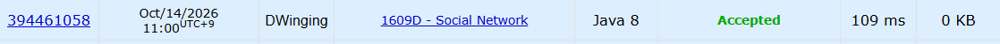

### Codeforces 1600 [1609D - Social Network](https://codeforces.com/problemset/problem/1609/D) (Java)

> **날짜:** 2026년 10월 14일  
> **알고리즘:** 정렬, 자료구조, 분리 집합, 그리디  
> **언어:** Java  
> **핵심 키워드:** 정렬, DSU, Union-Find, 그리디

## 📌 문제 개요

- 처음에는 서로 모르는 `n`명에 대해 연결되어야 할 두 사람의 조건이 `d`개 순서대로 주어진다.
- 두 사람은 직접 아는 사이이거나 지인을 따라 이어져 있으면 연결된 것으로 본다.
- `i`번째 조건까지 만족하면서 정확히 `i`번 소개한 상태를 각 단계마다 독립적으로 고려한다.
- 각 단계에서 한 사람이 가질 수 있는 지인의 최대 수를 출력한다.

---

## 💡 풀이 핵심 (Core Logic)

### 1. 분리 집합으로 연결 요소 관리

`parents`와 `find`로 두 사람이 이미 같은 연결 요소에 속하는지 확인한다. `cnt`에는 연결 요소의 크기보다 1 작은 값을 저장하고, 서로 다른 요소를 병합할 때 두 값의 합에 1을 더해 갱신한다.

이미 같은 연결 요소에 속한다면 병합하지 않고 `connect`를 증가시켜, 다른 연결 요소들을 추가로 이을 수 있는 소개 횟수를 관리한다.

### 2. 연결 요소의 크기를 내림차순으로 유지

서로 다른 요소를 합칠 때 `changeValue`로 `arr`의 기존 두 값을 병합된 크기와 `-1`로 변경한 뒤 내림차순 정렬한다.

이후 유효한 연결 요소의 개수인 `group`을 감소시켜 정렬 범위를 관리한다. 이를 통해 큰 연결 요소부터 선택할 수 있도록 유지한다.

### 3. 가장 큰 요소들을 합산해 답 계산

`connect`는 기본 1에서 시작하고, 같은 요소 안의 조건이 나올 때마다 증가한다.

`countConnect`는 현재 요소 수 `group`과 `connect` 중 작은 수만큼 앞에서부터 요소 크기를 더한 다음 1을 뺀다.

추가 연결 기회로 합칠 수 있는 가장 큰 요소들을 하나로 모았을 때, 그 안의 한 사람이 연결될 수 있는 나머지 사람 수다.

### 시간 복잡도

각 조건마다 `changeValue`의 선형 탐색과 최대 `n`개 값의 정렬을 수행한다. `find`는 경로 압축을 사용하므로 전체 시간 복잡도는 정렬이 지배하는 `O(d · n log n)`이고, 배열에 `O(n)` 공간을 사용한다.

- `n`: 사람 수
- `d`: 조건 수

---

## 🧠 회고 및 결론

재밌는 문제다. DSU를 활용하는 문제지만, 단순히 연결 요소를 관리하는 것보다 주어진 조건을 해석하는 과정이 중요했다.

특히 이미 연결된 두 정점이 주어졌을 때 추가로 다른 그룹을 연결할 수 있다는 점이 인상적이었다.

---

### 📂 소스 코드

[Solution.java](./Solution.java)

---

### 🖥️ 실행 결과

---
