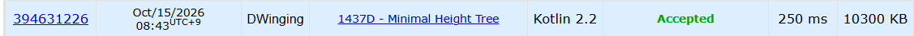
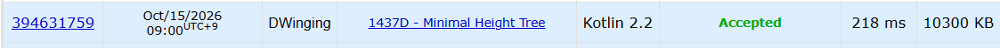

### Codeforces 1600 [1437D - Minimal Height Tree](https://codeforces.com/problemset/problem/1437/D) (Kotlin)

> **날짜:** 2026년 10월 15일  
> **알고리즘:** 두 포인터, 그리디  
> **언어:** Kotlin  
> **핵심 키워드:** 두 포인터, 그리디

## 📌 문제 개요

- 정점 `1`을 루트로 하는 트리에서 너비 우선 탐색으로 정점을 방문한다.
- 한 정점의 자식들은 번호가 작은 순서대로 탐색 대기열에 들어간다.
- 모든 정점을 한 번씩 방문한 순서가 주어지며, 첫 정점은 `1`이다.
- 주어진 방문 순서를 만족하는 트리의 최소 높이를 구한다.

---

## 💡 풀이 핵심 (Core Logic)

### 1. 자식 구간을 구분하는 감소 지점

너비 우선 탐색에서 같은 부모의 자식들은 번호가 증가하는 순서로 연속해서 나온다. 따라서 인접한 방문 번호가 감소하면 반드시 서로 다른 부모의 자식에 해당한다.

반대로 방문 번호가 증가한다고 해서 반드시 같은 부모의 자식인 것은 아니다. 다만 트리의 높이를 최소화하기 위해 증가하는 구간을 가능한 한 같은 부모에게 배정하는 그리디 방식을 적용할 수 있다.

두 풀이 모두 이러한 감소 지점을 기준으로 부모가 담당할 자식 구간을 구분하고, 각 층의 노드 수를 계산한다.

### 2. `Solution1.kt`: 부모 수를 갱신하며 층 세기

`pTotal`을 현재 층에서 사용할 부모 수로 두고, 감소 지점마다 `pCnt`를 늘린다.

`pCnt`가 `pTotal`에 도달하면 현재 층의 부모를 모두 사용한 것으로 보고 `level`을 증가시킨다.

이때 `idx`와 현재 위치의 차이로 다음 층에서 사용할 부모 수를 구하고, 감소 지점과 카운터를 새 층의 기준으로 갱신한다.

첫 층은 루트의 자식 층이므로 `level`을 1에서 시작한다.

### 3. `Solution2.kt`: 두 경계로 층 범위 이동

`start`와 `end` 사이의 길이 `len`을 현재 층의 부모 수로 삼는다.

`start`를 `end`로 옮기고 `level`을 증가시킨 뒤, 다음 방문 구간에서 감소 지점을 센다.

감소 횟수가 `len`에 도달하면 현재 층의 부모들이 담당할 수 있는 자식 구간을 모두 소진한 것이므로, 해당 위치부터 더 깊은 층에 배정한다.

이때 `end > start` 조건을 통해 이전 층에서 처리한 감소 지점을 중복 계산하지 않는다.

이 과정을 `end`가 배열 끝에 도달할 때까지 반복하여 최소 높이를 계산한다.

### 시간 복잡도

두 풀이 모두 각 테스트 케이스에서 방문 순서를 한 번 읽고 순차적으로 훑으므로 시간은 `O(n)`, 방문 순서를 저장하는 공간은 `O(n)`이다.

- `n`: 해당 테스트 케이스의 정점 수

---

## 🧠 회고 및 결론

BFS 탐색을 통해 답을 구하고자 하면 어려워지는 문제다. 

두 포인터 발상을 요구하는 간단한 문제다.

---

### 📂 소스 코드

[Solution1.kt](./Solution1.kt)  
[Solution2.kt](./Solution2.kt)

---

### 🖥️ 실행 결과

Solution1.kt  
    

Solution2.kt  

---