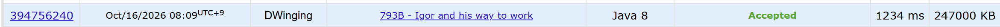

### Codeforces 1600 [793B - Igor and his way to work](https://codeforces.com/problemset/problem/793/B) (Java)

> **날짜:** 2026년 10월 16일  
> **알고리즘:** BFS, 최단거리, 그래프 탐색  
> **언어:** Java  
> **핵심 키워드:** 0-1BFS

## 📌 문제 개요

- `n × m` 격자가 주어지며, 행과 열의 크기는 각각 1 이상 1000 이하이다.
- 시작점 `S`와 도착점 `T`는 각각 하나씩 존재하며, 공사 중인 칸 `*`는 지나갈 수 없다.
- 상하좌우로 이동할 수 있고, 처음 이동할 방향은 자유롭게 선택한다.
- 이동 방향을 바꾸는 횟수는 최대 2회까지 허용된다.
- 조건을 만족하며 `S`에서 `T`로 이동할 수 있으면 `YES`, 없으면 `NO`를 출력한다.

---

## 💡 풀이 핵심 (Core Logic)

### 1. 위치와 방향을 함께 상태로 관리

같은 칸에 도착하더라도 현재 이동 방향에 따라 다음 이동에서 회전이 필요한지가 달라진다. 따라서 `visited[y][x][d]`에 해당 위치와 방향으로 도착하는 최소 회전 횟수를 저장한다.

모든 값을 3으로 초기화하고, 기존 값보다 회전 횟수가 작을 때만 상태를 갱신한다. 이 조건으로 회전 횟수가 3 이상인 경로는 덱에 들어가지 않아 최대 2회라는 제한을 지킨다.

`searchStart`로 `S`의 좌표를 찾은 뒤 네 방향의 시작 상태를 회전 횟수 0으로 등록한다. 처음 방향을 선택하는 행위를 회전으로 세지 않기 위해서다.

### 2. 회전 비용에 따라 덱의 앞뒤에 추가

덱에서 꺼낸 상태마다 상하좌우의 인접 칸을 확인한다. `check`로 격자 범위를 검사하고, 장애물이 아니면서 해당 방향의 최소 회전 횟수를 줄일 수 있는 경우에만 이동한다.

현재 방향을 유지하면 회전 비용이 0이므로 덱 앞에 추가하고, 방향을 바꾸면 회전 횟수를 1 늘려 덱 뒤에 추가한다. 이 0-1 BFS 처리로 회전 비용이 낮은 경로를 우선 탐색한다

이미 더 적은 회전 횟수로 갱신된 상태가 덱에 남아 있다면 건너뛰어 불필요한 탐색을 줄인다.

### 3. 도착 여부로 결과 판정

덱에서 꺼낸 유효한 상태의 칸이 `T`이면 `YES`를 반환한다. 덱에는 회전 횟수가 2 이하인 상태만 들어가므로 도착 즉시 조건을 만족하는 경로가 존재함을 알 수 있다.

덱이 빌 때까지 도착하지 못하면 조건을 만족하는 경로가 없으므로 `NO`를 반환한다.

### 시간 복잡도

격자 입력, 시작점 탐색, 방문 배열 초기화에 각각 `O(nm)`이 필요하다. 탐색 상태는 칸마다 네 방향이며 각 상태에서 네 방향의 이동만 확인한다. 회전 횟수는 0부터 2까지만 저장되므로 상태가 갱신되는 횟수도 상수로 제한되어 전체 시간 복잡도는 `O(nm)`이다.

격자, 방향별 방문 배열, 덱을 저장하는 공간 복잡도는 `O(nm)`이다.

- `n`: 격자의 행 수
- `m`: 격자의 열 수

---

## 🧠 회고 및 결론

간단한 0-1BFS 문제다. 다익스트라 풀이도 가능하며, 방향 전환이 최대 2회로 제한되어 있는 것이 특징이다.

---

### 📂 소스 코드

[Solution.java](./Solution.java)

---

### 🖥️ 실행 결과

---
