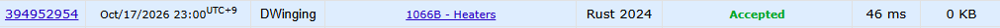

### Codeforces 1500 [1066B - Heaters](https://codeforces.com/problemset/problem/1066/B) (Rust)

> **날짜:** 2026년 10월 17일  
> **알고리즘:** 그리디  
> **언어:** Rust  
> **핵심 키워드:** 그리디

## 📌 문제 개요

- 길이 `n`인 배열에서 값이 `1`인 위치에만 히터가 있다.
- 위치 `pos`의 히터는 `pos-r+1`부터 `pos+r-1`까지의 칸을 데울 수 있다.
- 모든 칸을 데우는 데 필요한 히터의 최소 개수를 구하고, 불가능하면 `-1`을 출력한다.

---

## 💡 풀이 핵심 (Core Logic)

### 1. 첫 칸을 덮는 가장 오른쪽 히터 선택

`find_idx`는 주어진 범위에서 값이 `1`인 마지막 인덱스를 반환한다. 첫 칸을 데울 수 있는 `0..min(n, r)` 범위를 검색해 가장 오른쪽 히터를 고른다. 이 범위에 히터가 없으면 첫 칸을 데울 수 없으므로 `-1`을 반환한다.

### 2. 다음으로 덮어야 할 칸을 기준으로 반복

선택한 히터의 인덱스가 `idx`이면 `idx + r`을 아직 덮이지 않은 첫 칸인 `point`로 둔다. `point`가 배열 안에 있는 동안, 이 칸을 덮을 수 있는 `point-r+1`부터 `point+r-1`까지의 후보를 검색한다. 범위는 배열 경계에 맞춰 제한하고, 가장 오른쪽에 있는 히터를 골라 오른쪽으로 덮는 구간을 최대한 넓힌다. 후보가 없으면 현재 칸을 데울 수 없으므로 `-1`을 반환한다.

히터를 선택할 때마다 개수를 늘리고 `point`를 갱신한다. `point >= n`이면 모든 칸이 덮였으므로 선택한 히터 수를 반환한다.

### 시간 복잡도

`find_idx`는 한 번에 최대 `2r-1`개 위치를 확인하며, 반복마다 다음으로 덮어야 할 칸이 오른쪽으로 이동한다. 따라서 시간 복잡도의 상한은 `O(nr)`이다. 입력 배열을 제외한 추가 공간은 `O(1)`이다.

- `n`: 배열의 칸 수
- `r`: 히터가 한쪽으로 데우는 거리의 기준값

---

## 🧠 회고 및 결론

그리디 문제다. 두 포인터로 접근이 가능할 것 같고 아이디어는 비슷하지만, 풀이는 다양할 것 같다.

---

### 📂 소스 코드

[main.rs](./main.rs)

---

### 🖥️ 실행 결과

---
