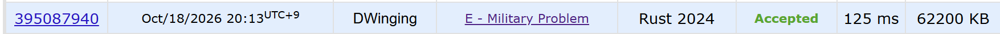

### Codeforces 1600 [Military Problem](https://codeforces.com/problemset/problem/1006/E) (Rust)

> **날짜:** 2026년 10월 18일  
> **알고리즘:** 트리, DFS  
> **언어:** Rust  
> **핵심 키워드:** 트리, DFS

## 📌 문제 개요

- 1번 장교를 루트로 하고, 나머지 장교는 각각 한 명의 직속 상관을 갖는다.
- 명령은 시작 장교를 포함한 서브트리에 DFS 순서로 전달된다.
- 직속 부하가 여러 명이면 번호가 작은 장교의 서브트리부터 방문한다.
- 각 질의는 시작 장교와 순서 `k`를 주며, 대상 장교가 없으면 `-1`을 출력한다.
- 각 질의에서 명령을 `k`번째로 받는 장교의 번호를 구한다.

---

## 💡 풀이 핵심 (Core Logic)

### 1. 번호순 자식 목록 구성

2번 장교부터 차례로 직속 상관의 자식 목록에 추가한다. 번호가 증가하는 순서로 추가되므로 각 목록은 별도 정렬 없이 작은 번호부터 탐색할 수 있다.

### 2. DFS 방문 순서와 서브트리 크기 기록

`create_tree`는 장교를 방문할 때 현재 DFS 인덱스를 `start[node]`에 저장하고, 장교 번호를 `tree`에 기록한다. 자식 서브트리의 크기를 `size[node]`에 누적한다. 자식들을 순서대로 끝까지 방문하므로 한 장교의 서브트리는 `tree`에서 연속 구간이 된다.

### 3. 질의에 배열 인덱스로 답하기

`k`가 `size[node]`보다 크면 해당 순서의 장교가 없으므로 `-1`을 출력한다. 그렇지 않으면 서브트리의 시작 위치에서 `k - 1`칸 떨어진 `tree[start[node] + k - 1]`을 출력한다.

### 시간 복잡도

트리를 만들고 DFS로 모든 장교를 한 번씩 방문하는 데 `O(n)`, 질의 `m`개를 처리하는 데 `O(m)`이 걸려 전체 시간 복잡도는 `O(n + m)`이다.

- `n`: 장교 수
- `m`: 질의 수

---

## 🧠 회고 및 결론

서브 트리의 개수와 연관이 있다는 것은 쉽게 파악했다. 하지만, 최적화하는 발상이 어려웠다.

전위 순회를 통해 트리의 방문 순서를 기록하여 1차원 배열로 평탄화 시키는 것이 까다로웠다.

---

### 📂 소스 코드

[main.rs](./main.rs)

---

### 🖥️ 실행 결과

---
