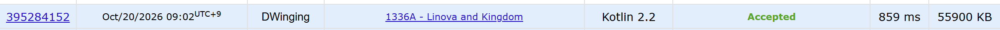

### Codeforces 1600 [Linova and Kingdom](https://codeforces.com/problemset/problem/1336/A) (Kotlin)

> **문제 번호:** 1336A  
> **날짜:** 2026년 10월 20일  
> **알고리즘:** 트리, 그리디, 정렬  
> **언어:** Kotlin  
> **핵심 키워드:** 트리, 그리디, 정렬

## 📌 문제 개요

- `n`개의 도시와 `n - 1`개의 양방향 도로가 트리를 이룬다 (`2 ≤ n ≤ 200,000`).
- 1번 도시가 수도이며, 수도도 산업 도시 또는 관광 도시로 지정할 수 있다.
- 정확히 `k`개 도시를 산업 도시로 선택하고 나머지는 관광 도시로 지정한다 (`1 ≤ k < n`).
- 각 산업 도시의 사절은 수도까지의 유일한 최단 경로를 따라 이동한다.
- 사절의 행복도는 이동 경로에 포함된 관광 도시의 수다.
- 모든 사절의 행복도 합의 최댓값을 구한다.

---

## 💡 풀이 핵심 (Core Logic)

### 1. DFS로 깊이와 서브트리 크기 계산

양방향 인접 리스트를 만든 뒤 1번 도시를 깊이 0인 루트로 삼아 `dfs`를 수행한다. 부모로 되돌아가는 간선을 제외하여 각 도시를 한 번씩 방문하고, `route[v][0]`에 깊이를 기록한다.

`route[v][1]`은 자기 자신을 포함하도록 1로 초기화한다. 자식의 DFS가 반환한 서브트리 크기를 더해 현재 도시의 서브트리 크기를 완성하고 부모에게 반환한다. 이 두 값은 산업 도시 선택으로 얻는 이득과 하위 도시에서 발생하는 손실을 함께 비교하는 데 필요하다.

### 2. 산업 도시 선택 점수로 내림차순 정렬

각 도시의 점수를 `깊이 - 서브트리 크기 + 1`로 계산한다. 깊이는 수도까지의 조상 수이므로 경로에서 얻을 수 있는 행복도에 해당한다. 여기서 자신을 제외한 서브트리의 도시 수를 빼면, 현재 도시를 산업 도시로 바꿀 때 하위 산업 도시의 사절들이 관광 도시 하나를 잃는 영향을 반영할 수 있다.

자손은 조상보다 깊이가 크고 서브트리가 작으므로 항상 점수가 더 높다. 따라서 점수가 높은 순서로 선택하면 어떤 도시가 선택될 때 그 도시의 모든 자손은 이미 산업 도시로 선택되어 있다.

이 성질 덕분에 선택된 도시의 전체 자손 수가 실제 하위 산업 도시 수와 일치한다. 따라서 선택한 도시들의 점수를 합산하여 전체 행복도 합을 계산할 수 있으며, 점수 내림차순으로 `k`개 도시를 선택하는 그리디가 성립한다.

코드는 `Arrays.sort`로 `route`의 1번부터 `n`번 원소까지만 점수 내림차순으로 정렬한다. 이후에는 도시 번호 대신 점수 순서만 필요하므로 깊이와 서브트리 크기를 담은 원소 자체를 정렬한다.

### 3. 상위 k개 점수를 합산

정렬된 배열의 1번부터 `k`번까지 점수를 더해 정확히 `k`개의 산업 도시를 선택했을 때의 최대 행복도 합을 구한다. 합계가 `Int` 범위를 넘을 수 있으므로 누적 변수 `res`는 `Long`을 사용하고, 각 점수도 `Long`으로 변환하여 더한다.

### 시간 복잡도

인접 리스트 구성과 DFS는 `O(n)`, 도시별 점수에 따른 정렬은 `O(n log n)`, 상위 점수 합산은 `O(k)`이다. 따라서 전체 시간 복잡도는 `O(n log n)`이다.

- `n`: 도시 수
- `k`: 선택해야 하는 산업 도시 수

---

## 🧠 회고 및 결론

트리에서 그리디 발상은 아직 어렵다.

---

### 📂 소스 코드

[Solution.kt](./Solution.kt)

---

### 🖥️ 실행 결과

---
