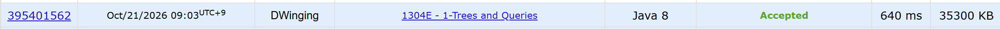

### Codeforces 2000 [1-Trees and Queries](https://codeforces.com/problemset/problem/1304/E) (Java)

> **문제 번호:** 1304E  
> **날짜:** 2026년 10월 21일  
> **알고리즘:** 트리, LCA  
> **언어:** Java  
> **핵심 키워드:** 트리, LCA, 홀짝 판정

## 📌 문제 개요

- `n`개의 정점과 `n - 1`개의 양방향 간선으로 이루어진 트리가 주어진다 (`3 ≤ n ≤ 100,000`).
- 각 질의는 `x, y, a, b, k`로 주어지며, 원래 연결되어 있지 않은 `x`와 `y` 사이에 양방향 간선 하나를 추가한다.
- 이동 중 같은 정점과 같은 간선을 여러 번 지날 수 있다.
- 질의는 서로 독립적이며, 추가한 간선은 해당 질의에만 적용된다.
- 최대 `100,000`개의 질의마다 `a`에서 `b`까지 정확히 `k`개의 간선을 거쳐 이동할 수 있는지 `YES` 또는 `NO`로 출력한다 (`1 ≤ k ≤ 10⁹`).

---

## 💡 풀이 핵심 (Core Logic)

### 1. BFS로 깊이와 조상 정보 구성

`inputList`에서 양방향 인접 리스트를 만들고, `buildTree`에서 1번 정점을 루트로 BFS를 수행한다. 트리이므로 직전 부모로 향하는 간선을 제외하면 각 정점을 한 번씩 방문할 수 있다.

자식을 발견하면 깊이와 바로 위 부모를 기록하고, `parents[j][v] = parents[j - 1][parents[j - 1][v]]`로 `2^j`번째 조상을 채운다. BFS에서 부모의 정보가 먼저 준비되므로 자식의 조상 정보를 즉시 구성할 수 있다. 이 정보는 질의마다 트리를 다시 탐색하지 않고 두 정점 사이의 거리를 구하기 위해 사용한다.

### 2. LCA를 이용해 트리에서의 거리 계산

`findLca`는 이름과 달리 공통 조상의 번호가 아니라 두 정점 사이의 **간선 수**를 반환한다. 먼저 깊이가 더 큰 정점을 깊이 차이의 비트에 따라 올려 두 정점의 깊이를 맞춘다. 이때 두 정점이 같아지면 조상과 자손 관계이므로 원래 깊이 차이가 곧 거리다.

두 정점이 다르면 큰 점프부터 확인하며 조상이 서로 다른 경우에만 두 정점을 함께 올린다. 이렇게 공통 조상 바로 아래까지 이동한 뒤, `depth[originA] + depth[originB] - 2 * depth[lca]`로 거리를 계산한다. 공통 조상까지의 두 구간만 더하므로 중복된 상위 경로는 제외된다.

### 3. 추가 간선 사용 여부와 방향에 따른 세 경로 계산

`solve`에서는 원래 트리의 거리를 `dist(u, v)`라고 할 때 다음 세 길이를 계산한다.

- `d1 = dist(a, b)`: 추가 간선을 사용하지 않는 경로.
- `d2 = dist(a, x) + 1 + dist(y, b)`: 추가 간선을 `x → y` 방향으로 사용하는 경로.
- `d3 = dist(a, y) + 1 + dist(x, b)`: 추가 간선을 `y → x` 방향으로 사용하는 경로.

추가 간선은 양방향이므로 두 방향을 모두 고려해야 한다. 추가 간선의 비용은 `1`이고 나머지 구간은 원래 트리에서 계산할 수 있으므로, 인접 리스트를 변경하거나 질의마다 조상 정보를 다시 구성할 필요가 없다.

### 4. 거리와 홀짝 조건으로 정확히 k번 이동 가능한지 판정

`check(d, k)`는 `d ≤ k`이고 `k - d`가 짝수인지 확인한다. 기본 경로보다 적게 이동할 수는 없지만, 간선을 따라 갔다가 되돌아오면 도착점을 유지한 채 이동 횟수를 2씩 늘릴 수 있기 때문이다.

따라서 세 후보 중 하나라도 이 조건을 만족하면 `YES`, 모두 만족하지 않으면 `NO`를 `StringBuilder`에 추가한다. 추가 간선을 이용하는 경로까지 함께 확인하므로 원래 트리 경로와 다른 홀짝의 이동 가능성도 반영한다.

### 시간 복잡도

인접 리스트 구성은 `O(n)`, BFS 중 조상 테이블 구성은 `O(n × LOG)`이다. 각 질의는 거리 계산을 다섯 번 수행하며, 각 거리 계산은 깊이 보정과 조상 탐색에 `O(LOG)`가 걸린다. 따라서 전체 시간 복잡도는 `O((n + q) × LOG)`이다.

코드의 `LOG`는 입력 상한에 맞춘 상수 `18`이다. 조상 테이블 높이를 일반적으로 `O(log n)`으로 표현하면 전체 시간 복잡도는 `O((n + q) log n)`이다.

- `n`: 트리의 정점 수
- `q`: 질의 수 (`solve`의 입력 변수 `m`)
- `LOG`: 이진 리프팅 조상 테이블의 높이

---

## 🧠 회고 및 결론

재밌는 문제였다. 홀짝 판정, LCA 등 핵심 로직은 모두 파악했으나 사이클에 집중하다보니, 마지막 로직을 놓친 것이 아쉽다.

---

### 📂 소스 코드

[Solution.java](./Solution.java)

---

### 🖥️ 실행 결과

---
