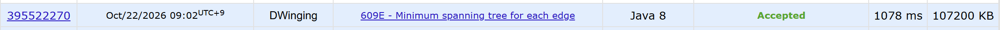

### Codeforces 2100 [Minimum spanning tree for each edge](https://codeforces.com/problemset/problem/609/E) (Java)

> **문제 번호:** 609E  
> **날짜:** 2026년 10월 22일  
> **알고리즘:** DSU, MST, LCA, BFS, 트리, 자료구조  
> **언어:** Java  
> **핵심 키워드:** Union-Find, 크루스칼, 트리, LCA, 이진 리프팅

## 📌 문제 개요

- 정점 `n`개와 간선 `m`개로 이루어진 연결된 무방향 가중치 그래프가 주어진다 (`1 ≤ n ≤ 200,000`, `n - 1 ≤ m ≤ 200,000`).
- 자기 자신을 잇는 간선과 같은 두 정점을 잇는 중복 간선은 없다.
- 각 간선의 가중치는 `1` 이상 `10⁹` 이하이며, 신장 트리의 가중치는 포함된 간선 가중치의 합이다.
- 각 간선에 대해 해당 간선을 반드시 포함하는 신장 트리의 최소 가중치를 입력 순서대로 출력한다.

---

## 💡 풀이 핵심 (Core Logic)

### 1. 크루스칼과 DSU로 기준 MST 구성

입력 간선은 `edge`에 입력 순서대로 저장하고, 가중치가 작은 간선부터 꺼낼 수 있도록 우선순위 큐에도 넣는다. `kruskal`은 간선을 하나씩 꺼내 `union`으로 양 끝점이 서로 다른 집합에 속하는지 확인한다. 다른 집합인 경우에만 연결해야 사이클 없이 최소 비용으로 모든 정점을 연결할 수 있다.

선택된 간선은 양방향 인접 리스트 `list`에 저장하고, `n - 1`개를 선택하면 종료한다. `find`는 경로 압축을 사용하며, `union`은 한 대표를 다른 대표 아래에 연결한다. 이후 모든 간선의 답을 이 MST에서 계산하므로 간선마다 트리를 새로 만들지 않는다. MST 가중치 합은 `int` 범위를 넘을 수 있어 `long`으로 저장한다.

### 2. BFS로 조상과 구간 최대 가중치 전처리

`buildTree`는 1번 정점을 루트로 BFS를 수행하며 각 정점의 깊이, 바로 위 부모, 부모로 향하는 간선의 가중치를 기록한다. MST는 트리이므로 직전 부모로 향하는 간선만 제외하면 각 정점을 한 번씩 방문할 수 있다.

`up[k][v]`에는 정점 `v`의 `2^k`번째 조상을, `maxWeight[k][v]`에는 그 조상까지 올라가는 경로의 최대 간선 가중치를 저장한다. 중간 조상을 `mid = up[k - 1][v]`로 두고 두 절반 구간의 정보를 합쳐 테이블을 구성한다. BFS에서는 부모의 정보가 먼저 준비되므로 자식을 발견하는 시점에 해당 테이블을 채울 수 있다. 이 전처리를 통해 긴 경로도 여러 간선을 한꺼번에 건너뛰며 조회할 수 있다.

### 3. LCA 탐색 과정에서 경로의 최대 간선 확인

`findLca`는 이름과 달리 공통 조상의 번호가 아니라 두 정점 사이 경로의 **최대 간선 가중치**를 반환한다. 먼저 더 깊은 정점을 깊이 차이만큼 올리면서 지나간 구간의 최대 가중치를 누적한다. 두 정점이 같아졌다면 필요한 경로를 모두 확인한 것이므로 바로 반환한다.

두 정점이 다르면 큰 점프부터 확인하면서 조상이 서로 다른 경우에만 양쪽 정점을 함께 올리고, 두 구간의 최대 가중치를 반영한다. 공통 조상 바로 아래에 도달한 뒤에는 양쪽에서 공통 조상으로 향하는 마지막 간선도 포함한다. 이렇게 해야 두 정점 사이 경로 전체를 빠짐없이 확인하면서 공통 조상 위의 불필요한 구간은 제외할 수 있다.

### 4. 간선 교체 비용으로 각 답 계산

가중치가 `w`인 간선 `(a, b)`가 MST에 없다면, 이를 추가할 때 기존 `a`와 `b` 사이 경로와 함께 사이클이 생긴다. 추가한 간선을 유지하면서 다시 트리로 만들려면 기존 경로의 간선 하나를 제거해야 하며, 가장 무거운 간선을 제거할 때 비용이 최소가 된다.

따라서 `findLca`로 구한 경로 최대 가중치를 `max`라고 할 때 답은 `weight - max + w`이다. 이미 MST에 포함된 간선도 두 끝점 사이 경로가 그 간선 자체이므로 `max = w`가 되어 같은 식으로 MST 가중치가 나온다. 코드는 포함 여부를 따로 나누지 않고 모든 간선에 이 식을 적용하며, `edge`의 입력 순서대로 `long` 결과를 `StringBuilder`에 모아 출력한다.

### 시간 복잡도

우선순위 큐에 간선을 넣고 꺼내는 데 `O(m log m)`, BFS 중 조상 및 최대 가중치 테이블을 채우는 데 `O(n × LOG)`, 모든 간선의 경로 최대값을 조회하는 데 `O(m × LOG)`가 걸린다.

DSU는 경로 압축만 사용하고 크기나 랭크에 따른 병합은 하지 않는다. 이 연산들의 보수적인 분할 상환 상한을 `O((n + m) log n)`으로 두면, 테이블 높이를 `LOG = O(log n)`으로 일반화한 전체 시간 복잡도는 `O(m log m + (n + m) log n)`이다. 실제 코드의 `LOG`는 입력 상한에 맞춘 상수 `19`이다.

- `n`: 정점 수
- `m`: 간선 수
- `LOG`: 이진 리프팅 테이블의 높이

---

## 🧠 회고 및 결론

문제가 2100점 답게 상당히 까다로웠다. 복합 알고리즘을 적용하여 해결해야하는 문제로, LCA, 이진 리프팅에 대한 숙련도가 부족하다는 것을 체감하였다.

---

### 📂 소스 코드

[Solution.java](./Solution.java)

---

### 🖥️ 실행 결과

---
