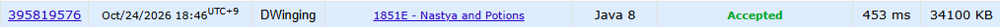

### Codeforces 1500 [Nastya and Potions](https://codeforces.com/problemset/problem/1851/E) (Java)

> **문제 번호:** 1851E  
> **날짜:** 2026년 10월 24일  
> **알고리즘:** 그리디, 그래프, DP, 위상 정렬  
> **언어:** Java  
> **핵심 키워드:** 위상 정렬, DP

## 📌 문제 개요

- 각 물약은 정해진 비용을 내고 구매할 수 있다.
- 일부 물약은 이미 무제한으로 가지고 있다.
- 물약에 조합법이 있으면 지정된 재료 물약들을 소모하여 만들 수 있다.
- 조합법이 없는 물약은 구매하거나, 이미 보유한 경우 무료로 얻을 수 있으며, 조합 관계에는 순환이 없다.
- 각 물약을 하나 얻는 데 필요한 최소 비용을 구한다.

---

## 💡 풀이 핵심 (Core Logic)

### 1. 구매 비용과 조합 의존성 준비

`cost[i]`에 물약의 구매 비용을 저장하고, 이미 무제한으로 가진 물약의 비용은 `0`으로 바꾼다. 각 조합의 재료 개수를 `cnt[i]`에 기록하고, 재료 물약에서 그 재료를 사용하는 물약으로 향하는 역방향 목록 `parents`를 만든다. 이 방향으로 연결해야 재료의 최소 비용이 확정된 뒤 조합 물약에 전달할 수 있다.

### 2. 재료가 없는 물약부터 위상 정렬

`cnt[i] == 0`인 물약을 큐에 넣는다. 이 물약들은 조합에 필요한 선행 재료가 없으므로 현재 `cost[i]`를 그대로 확정할 수 있다. 큐에서 물약을 꺼낼 때마다 이를 재료로 쓰는 물약의 남은 재료 수를 줄이고, 확정된 `cost`를 `dp`에 더한다.

### 3. 조합 비용과 구매 비용 비교

어떤 물약의 `cnt`가 `0`이 되면 모든 재료의 최소 비용이 `dp`에 합산된 상태다. `cost[i]`를 기존 구매 비용과 `dp[i]` 중 작은 값으로 갱신한 뒤 큐에 넣는다. 따라서 이후 물약에도 그 물약을 얻는 최소 비용이 전달된다. 마지막에 각 `cost[i]`를 출력한다.

### 시간 복잡도

각 물약은 큐에 한 번 들어가고, 각 재료 관계는 한 번 순회하므로 테스트 케이스당 시간은 `O(n + M)`, 공간은 `O(n + M)`이다.

- `n`: 물약 종류 수
- `M`: 모든 조합의 재료 수 합계

---

## 🧠 회고 및 결론

결국에는 물약을 구매할지 조합할지 결정하는 문제다. 조합을 한다고 했을때 조합에 필요한 물약의 비용을 최소로 하는 것이 핵심이었다.

---

### 📂 소스 코드

[Solution.java](./Solution.java)

---

### 🖥️ 실행 결과

---
