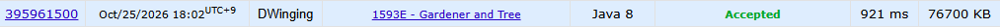

### Codeforces 1600 [Gardener and Tree](https://codeforces.com/problemset/problem/1593/E) (Java)

> **문제 번호:** 1593E  
> **날짜:** 2026년 10월 25일  
> **알고리즘:** 그래프, 자료 구조, 트리  
> **언어:** Java  
> **핵심 키워드:** 위상 정렬, BFS, 트리

## 📌 문제 개요

- 여러 테스트 케이스에서 `n`개의 정점으로 이루어진 트리가 주어진다.
- 리프는 연결된 정점이 최대 하나인 정점이며, 정점 하나만 남아도 리프에 해당한다.
- 한 번의 작업마다 현재 트리의 모든 리프를 동시에 제거한다.
- 작업을 `k`번 수행한 뒤 남은 정점의 수를 구한다.

---

## 💡 풀이 핵심 (Core Logic)

### 1. 인접 목록과 차수 구성

간선을 양방향 인접 목록 `list`에 저장하고 각 정점의 차수를 `cnt`에 센다. 리프가 제거될 때 연결된 정점의 차수를 줄여 새 리프를 찾아야 하므로 두 정보를 함께 준비한다. 정점이 하나이고 `k > 0`이면 첫 작업에서 사라지므로 바로 `0`을 반환한다.

### 2. 현재 리프를 라운드별로 제거

차수가 `1`인 정점을 배열 큐 `que`에 넣는다. 각 라운드 시작 시 `tail - head`를 `len`으로 고정하고 그만큼만 꺼내므로, 이번 라운드에 새로 생긴 리프는 다음 작업에서 제거된다. 꺼낸 정점의 이웃 차수를 줄이고 `1`이 된 이웃을 큐에 추가한다. 이때 `cnt[next] = 0`으로 표시해 다른 이웃을 처리할 때 같은 정점이 중복으로 큐에 들어가지 않게 한다.

### 3. 남은 정점 수 계산

큐가 빌 때까지 또는 `k`번의 라운드가 끝날 때까지 반복한다. `head`는 큐에서 꺼내 제거한 정점의 수이므로 `n - head`를 반환한다.

### 시간 복잡도

각 정점은 큐에 최대 한 번 들어가고, 제거된 정점의 인접 목록을 한 번씩 순회하므로 테스트 케이스당 시간은 `O(n)`, 공간은 `O(n)`이다.

- `n`: 트리의 정점 수

---

## 🧠 회고 및 결론

위상 정렬 방식을 응용하는 형태의 문제다. 노드가 1개 있고, K가 1 이상이라면, 0을 반환하는 예외를 놓치지 말아야한다.

---

### 📂 소스 코드

[Solution.java](./Solution.java)

---

### 🖥️ 실행 결과

---
