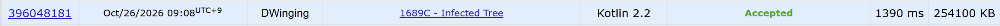

### Codeforces 1600 [Infected Tree](https://codeforces.com/problemset/problem/1689/C) (Kotlin)

> **문제 번호:** 1689C  
> **날짜:** 2026년 10월 26일  
> **알고리즘:** 트리, DP  
> **언어:** Kotlin  
> **핵심 키워드:** 트리에서의 DP

## 📌 문제 개요

- 정점 `1`을 루트로 하는 이진 트리에서 처음에는 루트만 감염되어 있다.
- 매 차례 감염되지 않은 정점 하나를 삭제하거나 아무것도 하지 않은 뒤, 감염이 연결된 이웃으로 퍼진다.
- 삭제된 정점은 감염에서 보호된 정점으로 세지 않는다.
- 감염되지 않고 삭제되지 않은 정점의 최대 개수를 구한다.

---

## 💡 풀이 핵심 (Core Logic)

### 1. 루트 기준으로 자식의 상태 계산

간선을 양방향 인접 목록에 저장한 뒤 `dfs(graph, parent, node)`로 부모 방향을 제외하고 자식부터 탐색한다. 각 호출은 `Node(child, remove)`를 반환한다. `child`는 현재 정점 아래의 자손 수이고, `remove`는 현재 정점이 감염된 상황에서 그 아래에서 지킬 수 있는 최대 정점 수다. 자손 수를 함께 계산해야 자식 정점을 삭제했을 때 그 아래에 남는 정점 수를 바로 알 수 있다.

### 2. 자식 수에 따라 보호할 정점 계산

자식이 없으면 지킬 정점이 없어 `(0, 0)`을 반환한다. 자식이 하나라면 그 자식을 삭제해야 감염을 막을 수 있으므로 자식의 자손 수만 `remove`에 담는다. 자식이 둘이면 한쪽 자식을 삭제하고 그쪽 자손 전체를 지키면서, 다른 쪽은 자식의 `remove`만큼 지킬 수 있다. 두 선택 중 큰 값인 `maxOf(a.child + b.remove, a.remove + b.child)`를 사용한다. 각 경우에 자손 수 `child`도 합산해 부모 호출에 전달한다.

### 3. 루트의 결과 출력

처음 감염된 정점이 루트 `1`이므로 각 테스트 케이스에서 `dfs(graph, -1, 1).remove`를 답으로 출력한다.

### 시간 복잡도

각 정점을 한 번 방문하고 간선을 인접 목록에서 순회하므로 테스트 케이스당 시간 `O(n)`, 공간 `O(n)`이다.

- `n`: 해당 테스트 케이스의 정점 수

---

## 🧠 회고 및 결론

트리에서의 DP 문제다. i번째 노드를 삭제 했을 때, 살릴 수 있는 값은 i번째 노드의 모든 자식이 되고, 유지한다면 서브 트리에 따라 달라진다.

핵심은 자식의 수에 따라 달라진다.

---

### 📂 소스 코드

[Solution.java](./Solution.java)

---

### 🖥️ 실행 결과

---
