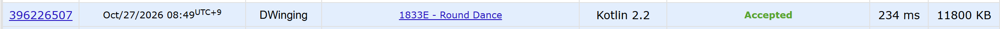

### Codeforces 1600 [Round Dance](https://codeforces.com/problemset/problem/1833/E) (Kotlin)

> **문제 번호:** 1833E  
> **날짜:** 2026년 10월 27일  
> **알고리즘:** DSU  
> **언어:** Kotlin  
> **핵심 키워드:** Union-Find

## 📌 문제 개요

- 각 춤에는 최소 두 사람이 참여하며, 모든 사람은 같은 춤에서 양옆에 이웃을 둔다.
- 두 사람만 춤추는 경우에는 양옆의 이웃이 같은 사람이다.
- 각 사람은 자신의 이웃 중 한 사람의 번호만 기억한다.
- 기억한 이웃 관계를 모두 만족하는 춤의 최소 개수와 최대 개수를 구한다.

---

## 💡 풀이 핵심 (Core Logic)

### 1. 기억한 이웃끼리 연결 요소 만들기

각 사람 `i`와 기억한 이웃 `arr[i]`를 `union`으로 묶는다. 서로 이웃이라고 기억한 사람은 같은 춤에 있어야 하므로, 합쳐진 연결 요소의 수가 가능한 춤의 최대 개수다. `find`는 경로 압축을 수행하고, 모든 연결 후 부모가 자기 자신인 사람의 수를 `maxCircle`로 센다.

### 2. 연결 수로 합칠 수 있는 요소 찾기

각 기억 관계의 양 끝에 연결 수를 더하되, 두 사람이 서로를 기억한 경우에는 같은 관계를 두 번 세지 않는다. 연결 수가 `1`인 사람은 양 끝을 이어 다른 춤과 합칠 수 있는 경로의 끝점이므로, 그 수를 `2`로 나눈 `temp`가 합칠 수 있는 요소의 개수다. 양 끝이 없는 닫힌 요소는 다른 요소와 합칠 수 없다.

### 3. 최소 춤 개수 계산하기

합칠 수 있는 요소가 있으면 모두 하나의 춤으로 묶어 `maxCircle - temp + 1`을 최소 개수로 삼는다. 그런 요소가 없으면 최대 개수가 그대로 최소 개수다. 각 테스트 케이스에서 이 두 값을 출력한다.

### 시간 복잡도

각 테스트 케이스에서 `n`번 합집합을 수행하고 배열을 선형 순회한다. 경로 압축을 사용하고 합집합 기준은 따로 두지 않은 구현의 상한은 `O(n log n)`, 공간 복잡도는 `O(n)`이다.

- `n`: 해당 테스트 케이스의 사람 수

---

## 🧠 회고 및 결론

간단한 Union-Find 문제로, 합쳐진 그룹의 수에 따라서 값을 계산하면 된다.

---

### 📂 소스 코드

[Solution.kt](./Solution.kt)

---

### 🖥️ 실행 결과

---
