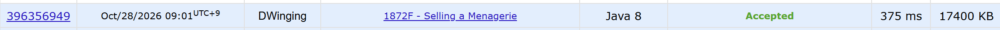

### Codeforces 1800 [Selling a Menagerie](https://codeforces.com/problemset/problem/1872/F) (Java)

> **문제 번호:** 1872F  
> **날짜:** 2026년 10월 28일  
> **알고리즘:** 정렬, DSU, 그래프  
> **언어:** Java  
> **핵심 키워드:** 정렬, Union-Find, 위상정렬

## 📌 문제 개요

- 각 동물은 자신이 두려워하는 다른 동물 한 마리와 판매 가격을 가진다.
- 두려워하는 동물이 아직 팔리지 않았다면 해당 동물을 팔 때 가격의 두 배를 받는다.
- 두려워하는 동물이 이미 팔렸다면 원래 가격만 받는다.
- 모든 동물을 팔아 얻는 총수익이 최대가 되도록 판매 순서를 구한다.

---

💡 풀이 핵심 (Core Logic)

### 1. 가격 내림차순으로 관계 검토

각 동물의 번호, 두려워하는 동물, 가격을 함께 저장하고 가격이 큰 순서로 정렬한다.
동물 i를 두려워하는 동물 a[i]보다 먼저 팔면 추가로 c[i]를 받으므로, 가격이 높은 동물의 선행 관계부터 우선적으로 확보한다.

### 2. DSU로 사이클을 피하며 선행 관계 구성

정렬된 순서대로 i → a[i] 관계를 검토한다.
양 끝의 DSU 대표가 다르면 간선을 추가하고 진입 차수를 늘린 뒤 두 집합을 합친다. 대표가 같으면 이 간선이 사이클을 완성하므로 추가하지 않는다.
각 동물은 정확히 하나의 다른 동물을 가리키므로, 연결 요소마다 사이클이 정확히 하나 존재한다.
사이클에 포함된 모든 선행 관계를 동시에 만족할 수는 없으므로, 적어도 하나의 관계를 포기해야 한다.
이때 가격이 가장 낮은 동물의 관계를 제외하면 손실을 최소화할 수 있다.
따라서 가격 내림차순으로 간선을 검토하고 DSU로 사이클을 방지하면, 각 사이클에서 가격이 가장 낮은 동물의 관계만 제외되어 최대 수익을 얻을 수 있다.

### 3. 위상 정렬로 판매 순서 출력

진입 차수가 0인 동물을 큐에 넣고 순서대로 꺼낸다.
꺼낸 동물의 간선이 향하는 동물의 진입 차수를 줄여 0이 되면 큐에 추가한다.
이렇게 하면 추가한 모든 i → a[i] 관계에서 i가 먼저 출력되어 최대 수익을 얻는 판매 순서가 된다.

### 시간 복잡도

가격 정렬에 O(n log n)이 들고, DSU 간선 검사와 위상 정렬에도 O(n log n) 이하가 들어 전체 시간 복잡도는 O(n log n)이다.
배열과 그래프에 사용하는 공간은 O(n)이다.
n: 한 테스트 케이스의 동물 수

---

## 🧠 회고 및 결론

문제를 보면서 풀이를 꽤 고민했다.

처음에는 판매 순서를 그래프로 구성하고, 탐색을 통해 출력하는 방식을 생각했다. 하지만 사이클이 발생하면 모든 관계를 만족시킬 수 없으므로, 어떤 관계를 우선적으로 선택할 것인가에서 고민이 생겼다.

예제의 출력 결과를 분석해 보니, 가격이 높은 동물의 관계를 우선적으로 만족시키는 형태로 보였다. 이 점에서 힌트를 얻어 가격순으로 정렬하고, DSU로 사이클을 방지하며 관계를 구성한 뒤, 위상 정렬로 출력하는 방식으로 접근했다.

---

### 📂 소스 코드

[Solution.java](./Solution.java)

---

### 🖥️ 실행 결과

---
