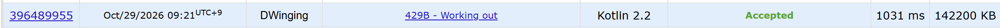

### Codeforces 1600 [Working out](https://codeforces.com/problemset/problem/429/B) (Kotlin)

> **문제 번호:** 429B  
> **날짜:** 2026년 10월 29일  
> **알고리즘:** DP  
> **언어:** Kotlin  
> **핵심 키워드:** DP

## 📌 문제 개요

- `n × m` 격자의 각 칸에는 운동으로 얻는 칼로리가 주어진다.
- 첫 번째 사람은 왼쪽 위에서 오른쪽 아래까지 아래쪽 또는 오른쪽으로 이동한다.
- 두 번째 사람은 왼쪽 아래에서 오른쪽 위까지 위쪽 또는 오른쪽으로 이동한다.
- 두 사람은 정확히 한 칸에서 만나며, 그 칸에서는 둘 다 운동하지 않는다.
- 두 사람이 운동한 칸의 칼로리 합의 최댓값을 구한다.

---

## 💡 풀이 핵심 (Core Logic)

### 1. 네 방향의 경로 합 계산

`settingDp`를 네 번 호출해 각 칸에서 아래·오른쪽, 위·왼쪽, 위·오른쪽, 아래·왼쪽 방향으로 이어지는 최대 경로 합을 구한다. `man`과 `woman`의 방향별 값은 현재 칸을 제외하고 다음 칸의 칼로리부터 더한다. 따라서 만남 칸의 칼로리를 별도로 빼지 않아도 된다. 각 호출은 참조하는 다음 칸이 먼저 계산되도록 행과 열의 순회 방향을 정한다.

### 2. 만남 칸의 두 가지 경로 배치 비교

`solve`는 경계가 아닌 모든 칸을 만남 칸으로 검토한다. 첫 번째 배치에서는 `man`의 위·아래 경로와 `woman`의 왼쪽·오른쪽 경로를 합하고, 두 번째 배치에서는 두 사람의 수직·수평 경로를 바꿔 합한다. 만남 칸 주위에서 경로가 겹치지 않으려면 수직과 수평으로 갈라져야 하므로 두 배치를 모두 비교한다.

### 3. 전체 최댓값 선택

각 만남 칸에서 두 배치의 합 중 큰 값을 `res`와 비교해 갱신한다. 모든 가능한 만남 칸을 확인한 뒤 최대 칼로리 합을 출력한다.

### 시간 복잡도

네 번의 DP 계산과 내부 칸 순회가 각각 격자 크기에 비례하므로 시간 복잡도는 `O(nm)`이다. 격자와 방향별 DP 배열을 저장하는 공간 복잡도도 `O(nm)`이다.

- `n`: 격자의 행 수
- `m`: 격자의 열 수

---

## 🧠 회고 및 결론

문제가 어렵다기보다 코드 구현에서 실수하기 쉬운 문제다.

코틀린은 범위를 객체로 활용할 수 있는 것이 신기했다.

---

### 📂 소스 코드

[Solution.kt](./Solution.kt)

---

### 🖥️ 실행 결과

---
