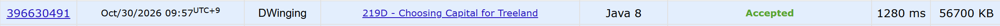

### Codeforces 1700 [Choosing Capital for Treeland](https://codeforces.com/problemset/problem/219/D) (Java)

> **문제 번호:** 219D  
> **날짜:** 2026년 10월 30일  
> **알고리즘:** 트리, DP  
> **언어:** Java  
> **핵심 키워드:** 트리에서의 DP

## 📌 문제 개요

- `n`개의 도시와 방향이 있는 `n-1`개의 도로가 주어진다.
- 도로의 방향을 무시하면 모든 도시는 연결되어 있다.
- 수도를 정하면 그 도시에서 나머지 모든 도시까지 도로의 방향을 따라 이동할 수 있어야 한다.
- 필요하다면 도로의 방향을 뒤집을 수 있다.
- 뒤집는 도로 수의 최솟값과 이를 달성하는 모든 수도 번호를 오름차순으로 구한다.

---

## 💡 풀이 핵심 (Core Logic)

### 1. 도로 방향을 비용으로 저장

입력 도로 `u → v`를 인접 리스트에 양쪽으로 저장하면서 `u → v`에는 비용 `0`, `v → u`에는 비용 `1`을 붙인다. 특정 도시를 수도로 삼아 트리 바깥쪽으로 이동할 때 비용 `1`인 도로가 뒤집어야 하는 도로이기 때문이다.

### 2. 1번 도시를 수도로 하는 비용 계산

`dfs`는 부모로 되돌아가는 간선을 제외하고 각 자식 서브트리의 비용과 자식으로 향하는 간선의 비용을 합해 `dp[node]`에 저장한다. 따라서 `dp[1]`은 1번 도시에서 모든 도시로 이동할 수 있게 만드는 데 필요한 도로 반전 횟수다.

### 3. 수도를 옮기며 최소 비용의 도시 수집

`solve`는 1번 도시에서 현재 도시까지의 간선 수 `depth`와 그 경로에서 비용이 `1`인 간선 수 `val`을 전달한다. 경로 밖의 도로는 수도를 바꿔도 필요한 방향이 같고, 경로 위 도로만 필요한 방향이 반대로 바뀐다. 따라서 현재 도시를 수도로 할 때의 반전 횟수는 `dp[1] + depth - 2 × val`이다. 이 값을 최소값과 비교해 해당 도시를 `stack`에 모은다.

### 4. 수도 번호 정렬 및 출력

최솟값을 만드는 도시 번호를 오름차순으로 출력해야 하므로 `stack`의 사용 구간만 정렬한 뒤 최솟값과 함께 출력한다.

### 시간 복잡도

두 번의 트리 순회는 각각 `O(n)`이고, 후보 도시 정렬은 최악의 경우 `O(n log n)`이므로 전체 시간 복잡도는 `O(n log n)`이다. 인접 리스트, 배열과 재귀 호출에 사용하는 공간은 `O(n)`이다.

- `n`: 도시의 수

---

## 🧠 회고 및 결론

처음에는 0-1 BFS와 LCA를 생각했지만, 트리의 특성을 이용하면 DFS 두 번으로 해결할 수 있었다.

첫 번째 DFS에서 1번 정점을 수도로 선택했을 때의 비용을 계산하고, 두 번째 DFS에서 수도가 이동하는 경로의 간선 방향만 고려하면 된다는 점이 핵심이었다.

처음에는 서브트리의 비용을 활용하려고 했지만, 전체 트리의 비용을 기준으로 계산하는 것이 더 간단했다.

구현 자체는 어렵지 않았지만, 비용 계산식을 정리하는 과정에서 조금 고민했던 문제다.

---

### 📂 소스 코드

[Solution.java](./Solution.java)

---

### 🖥️ 실행 결과

---
