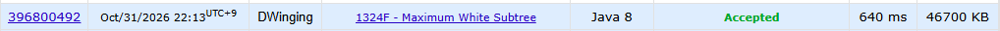

### Codeforces 1800 [Maximum White Subtree](https://codeforces.com/problemset/problem/1324/F) (Java)

> **문제 번호:** 1324F  
> **날짜:** 2026년 10월 31일  
> **알고리즘:** 트리, DP  
> **언어:** Java  
> **핵심 키워드:** 트리에서의 DP

## 📌 문제 개요

- `n`개의 정점과 `n-1`개의 간선으로 이루어진 트리가 주어진다.
- 각 정점은 흰색 또는 검은색이며, 색은 각각 `1`과 `0`으로 입력된다.
- 선택한 부분 트리는 연결되어 있어야 하고, 기준 정점을 반드시 포함해야 한다.
- 선택한 부분 트리의 점수는 흰색 정점 수에서 검은색 정점 수를 뺀 값이다.
- 모든 정점에 대해 그 정점을 포함하는 부분 트리의 최대 점수를 구한다.

---

## 💡 풀이 핵심 (Core Logic)

### 1. 정점 색을 점수로 바꾸고 트리 구성

`inputColor`는 흰색을 `+1`, 검은색을 `-1`로 바꿔 저장하고, `inputEdge`는 간선을 양방향 인접 리스트에 담는다. 이렇게 하면 연결된 정점 집합의 색 차이를 정점 점수의 합으로 계산할 수 있다.

### 2. 아래쪽 서브트리의 점수 계산

`settingTree`는 1번 정점을 뿌리로 두고 부모를 제외한 자식들을 재귀적으로 방문한다. `val[node]`에 자신의 점수와 각 자식이 반환한 양수 기여분을 더한다. 음수인 자식 쪽은 포함할수록 점수가 낮아지므로 부모에게는 `0`을 반환하지만, 해당 정점의 원래 계산값은 `val[node]`에 남긴다.

### 3. 부모 방향의 결과 전파

`solve`는 부모의 갱신된 `val[p]`와 현재 정점의 아래쪽 계산값을 비교하며 위쪽에서 얻을 수 있는 점수를 반영한다. 현재 값이 `0` 이상이면 부모의 결과를 그대로 포함할 수 있어 두 값 중 큰 값을 택한다. 음수이면 부모 결과에 현재 정점의 점수 `color[node]`를 더한 값과 자신의 계산값 중 큰 값을 택한다. 부모를 먼저 갱신한 뒤 자식을 방문하므로 최종 `val[i]`를 정점 순서대로 출력한다.

### 시간 복잡도

두 번의 트리 순회와 결과 문자열 작성에 각각 `O(n)`이 걸리므로 전체 시간 복잡도는 `O(n)`이다. 인접 리스트, 배열, 재귀 호출에 필요한 공간은 `O(n)`이다.

- `n`: 정점의 수

---

## 🧠 회고 및 결론

트리 DP 문제 점화식에 많이 익숙해졌다.

---

### 📂 소스 코드

[Solution.java](./Solution.java)

---

### 🖥️ 실행 결과

---
