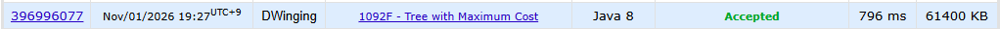

### Codeforces 1900 [Tree with Maximum Cost](https://codeforces.com/problemset/problem/1092/F) (Java)

> **문제 번호:** 1092F  
> **날짜:** 2026년 11월 01일  
> **알고리즘:** 트리, DP  
> **언어:** Java  
> **핵심 키워드:** 트리에서의 DP

## 📌 문제 개요

- `n`개의 정점과 `n-1`개의 간선으로 이루어진 트리가 주어진다.
- 각 정점 `i`에는 가중치 `a_i`가 주어진다.
- 정점 `v`를 선택했을 때 비용은 모든 정점에 대해 `v`까지의 거리와 가중치를 곱한 값의 합이다.
- 임의의 정점을 `v`로 선택하여 얻을 수 있는 최대 비용을 구한다.

---

## 💡 풀이 핵심 (Core Logic)

### 1. 가중치와 트리 구성

각 정점의 가중치를 `cost`에 저장하고 간선을 양방향 인접 리스트에 담는다. 이후 부모 정점을 제외하고 자식을 방문해 트리의 각 간선을 한 번씩 처리한다.

### 2. 1번 정점을 기준으로 서브트리 합과 비용 계산

`dfs`는 `total[node]`에 해당 서브트리의 가중치 합을, `val[node]`에 현재 정점에서 그 서브트리 정점들까지의 거리 비용을 저장한다. 자식의 거리 비용 `val[child]`에 가중치 합 `total[child]`를 더하면 자식 쪽 모든 정점이 부모에게서 한 칸 멀어진 비용이 된다. 이 값을 합산해 전체 트리를 1번 정점에서 본 비용 `val[1]`을 구한다.

### 3. 루트를 옮기며 최대 비용 갱신

`solve`는 1번 정점의 비용에서 현재 정점의 비용까지 누적된 차이 `diff`를 전달한다. 부모에서 자식으로 기준점을 옮기면 자식 서브트리의 거리 비용은 `total[child]`만큼 줄고 나머지 정점의 거리 비용은 `total[1] - total[child]`만큼 늘어난다. 따라서 `diff + total[1] - 2 * total[child]`를 다음 차이로 사용하고, 각 정점의 `val[1] + diff` 중 최댓값을 `res`에 저장한다.

### 시간 복잡도

두 번의 트리 순회에서 각 정점과 간선을 상수 번 처리하므로 시간 복잡도는 `O(n)`이다. 인접 리스트와 배열, 재귀 호출 스택을 포함한 공간 복잡도는 `O(n)`이다.

- `n`: 정점의 수

---

## 🧠 회고 및 결론

트리 DP 문제에 많이 익숙해졌다. 다른 유형 문제를 풀 때가 되었다.

---

### 📂 소스 코드

[Solution.java](./Solution.java)

---

### 🖥️ 실행 결과

---
