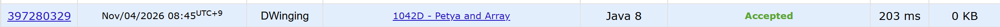

### Codeforces 1800 [Petya and Array](https://codeforces.com/problemset/problem/1042/D) (Java)

> **문제 번호:** 1042D  
> **날짜:** 2026년 11월 04일  
> **알고리즘:** 분할 정복, 누적 합, 두 포인터, 정렬  
> **언어:** Java  
> **핵심 키워드:** 분할 정복, 누적 합, 두 포인터, 병합 정렬

## 📌 문제 개요

- 길이 `n`의 정수 배열과 기준값 `t`가 주어진다.
- 배열에는 음수, 0, 양수가 모두 포함될 수 있다.
- 비어 있지 않은 연속 구간의 원소 합이 `t`보다 작은 경우를 센다.
- 조건을 만족하는 연속 구간의 총개수를 출력한다.

---

## 💡 풀이 핵심 (Core Logic)

### 1. 누적합으로 구간 합 표현

입력 배열의 누적합 `prefix[0..n]`을 만든다. 시작점과 끝점에 해당하는 두 누적합의 차이가 구간 합이므로, `i < j`이고 `prefix[j] - prefix[i] < t`인 쌍을 세는 문제로 바꾼다. 코드에서는 기준값 `t`를 `m`으로 읽는다.

### 2. 인덱스 범위를 분할해 쌍 계산

`solve`는 누적합의 인덱스 범위를 반으로 나누고, 양쪽 내부의 유효한 쌍을 재귀적으로 센다. 나머지는 왼쪽에 시작 인덱스가 있고 오른쪽에 끝 인덱스가 있는 쌍이므로 `countValue`에서 따로 계산한다. 이렇게 나누면 두 인덱스의 원래 순서 `i < j`가 유지된다.

### 3. 정렬된 양쪽 구간을 두 포인터로 순회

재귀 호출이 끝난 양쪽 누적합 구간은 각각 오름차순이다. `countValue`는 왼쪽 값마다 오른쪽 포인터 `j`를 `prefix[j] - prefix[i] < m`인 동안 전진시키고, 조건을 만족한 오른쪽 원소 수 `j - (mid + 1)`을 더한다. 왼쪽 값도 오름차순으로 커지므로 `j`를 되돌릴 필요가 없어 교차 쌍을 선형 시간에 센다.

### 4. 두 구간 병합

교차 쌍을 센 뒤 `arr`를 임시 배열로 사용해 양쪽 구간을 오름차순으로 병합하고 `prefix`에 복사한다. 상위 재귀 단계에서도 정렬된 양쪽 구간을 두 포인터로 처리하기 위해서다.

### 시간 복잡도

각 분할 단계에서 교차 쌍 계산과 병합에 `O(n)`이 걸리고 분할 깊이는 `O(log n)`이므로 전체 시간 복잡도는 `O(n log n)`이다. 누적합과 병합용 배열에 `O(n)` 공간을 사용한다.

- `n`: 입력 배열의 길이

---

## 🧠 회고 및 결론

분할 정복은 언제나 어렵다. 병합 정렬을 응용해볼가 라는 생각까지는 했지만, 누적 합 발상은 떠올리지 못했다.

---

### 📂 소스 코드

[Solution.java](./Solution.java)

---

### 🖥️ 실행 결과

---
