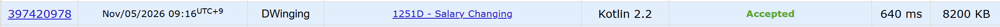

### Codeforces 1900 [Salary Changing](https://codeforces.com/problemset/problem/1251/D) (Kotlin)

> **문제 번호:** 1251D  
> **날짜:** 2026년 11월 05일  
> **알고리즘:** 그리디, 정렬, 이분 탐색  
> **언어:** Kotlin  
> **핵심 키워드:** 파라매트릭 서치, 그리디, 정렬

## 📌 문제 개요

- 홀수 명의 직원마다 지급 가능한 급여 범위 `[l_i, r_i]`가 주어진다.
- 모든 직원에게 각자의 범위 안에서 급여를 지급해야 한다.
- 급여 총액은 예산 `s`를 넘을 수 없다.
- 지급한 급여의 중앙값을 최대한 크게 만들고, 그 값을 구한다.

---

## 💡 풀이 핵심 (Core Logic)

### 1. 급여 하한 내림차순 정렬

직원을 급여 하한 `l_i`가 큰 순서로 정렬한다. 중앙값 후보 이상을 받을 직원을 골라야 할 때, 하한이 큰 직원부터 선택하면 그 값을 맞추기 위해 추가로 필요한 급여가 작아진다.

### 2. 중앙값 후보의 가능 여부 판정

`solve`는 정렬된 직원을 순서대로 보며 상한 `r_i`가 후보 `mid` 이상인 직원 중 `n / 2 + 1`명을 선택한다. 선택한 직원에게는 `max(l_i, mid)`를, 나머지 직원에게는 최소 급여 `l_i`를 지급한 것으로 합산한다. 필요한 인원을 채웠고 합계가 예산 `s` 이하일 때만 후보가 가능하다.

### 3. 최대 중앙값 이분 탐색

`0`부터 `s`까지 중앙값 후보를 이분 탐색한다. `solve`가 참이면 후보를 답으로 저장하고 더 큰 값을 확인하며, 거짓이면 범위를 낮춘다. 후보가 커질수록 가능 조건이 까다로워지므로 가능한 최대값을 찾을 수 있다.

### 시간 복잡도

직원 정렬에 `O(n log n)`, 이분 탐색의 각 가능 여부 판정에 `O(n)`이 걸린다. 테스트 케이스당 전체 시간 복잡도는 `O(n log n + n log s)`이다.

- `n`: 해당 테스트 케이스의 직원 수
- `s`: 급여 총예산

---

## 🧠 회고 및 결론

이분 탐색, 정렬, 그리디 발상까지는 좋았으나 문제를 처리하는 과정과 판단 조건을 잘못 이해했다.
중앙값이 정확히 mid 여야 한다고 생각했지만, 실제로는 중앙값이 mid 이상인지를 판단하면 충분했다.

이분 탐색은 아직 이해도가 부족한 것 같다. 연습이 필요하다.

---

### 📂 소스 코드

[Solution.kt](./Solution.kt)

---

### 🖥️ 실행 결과

---
