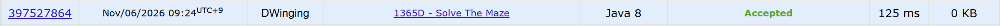

### Codeforces 1700 [Solve The Maze](https://codeforces.com/problemset/problem/1365/D) (Java)

> **문제 번호:** 1365D  
> **날짜:** 2026년 11월 06일  
> **알고리즘:** 그래프 이론, 그래프 탐색, BFS  
> **언어:** Java  
> **핵심 키워드:** 최단거리, BFS

## 📌 문제 개요

- `n × m` 미로의 각 칸은 빈칸 `.`, 벽 `#`, 좋은 사람 `G`, 나쁜 사람 `B` 중 하나이다.
- 사람은 벽이 아닌 상하좌우 인접 칸으로 이동할 수 있으며, 출구는 오른쪽 아래 칸이다.
- 빈칸 일부를 벽으로 바꿀 수 있지만 `G`와 `B`가 있는 칸은 막을 수 없다.
- 모든 좋은 사람은 출구로 나가고 모든 나쁜 사람은 나갈 수 없게 만들 수 있는지 판정한다.

---

## 💡 풀이 핵심 (Core Logic)

### 1. 원래 좋은 사람 수 기록

`countGoodPerson`으로 벽을 세우기 전의 `G` 수를 센다. 이후 미로를 변경하더라도 처음 있던 모든 좋은 사람이 출구에 도달하는지 비교하기 위해서다.

### 2. 나쁜 사람 주변 차단

`buildWall`은 각 `B`의 상하좌우에서 `B`가 아닌 칸을 `#`로 바꾼다. 빈 통로를 막아 나쁜 사람과 출구를 분리한다. 인접한 `G`도 배열에서는 `#`가 되지만 원래 `G` 수는 유지되므로, 이런 경우에는 최종 도달 수가 부족해 `NO`가 된다.

### 3. 출구에서 BFS로 도달 여부 확인

출구가 `.`일 때만 큐에 넣고, 벽이 아닌 인접 칸을 한 번씩 방문한다. 새로 방문한 `G`의 수가 처음 센 `G` 수와 같으면 `YES`, 다르면 `NO`를 출력한다. 코드에서 BFS는 최단거리 값을 구하지 않고 도달 가능한 칸을 확인하는 데 사용된다.

### 시간 복잡도

좋은 사람 수 계산, 벽 설치, BFS가 각각 미로를 최대 한 번씩 훑으므로 테스트 케이스당 `O(nm)`이다.

- `n`: 미로의 행 수
- `m`: 미로의 열 수

---

## 🧠 회고 및 결론

처음에는 벽의 개수가 정해져있나 라는 생각을 했지만, 문제를 읽어보니 그런 조건이 없어서 쉽게 푼 문제다.

그래서 결국에는 그냥 B를 기준으로 벽을 세우는 전처리를 수행하고 탈출구(n, m)에서 역으로 탐색하면 풀리는 간단한 문제였다.

---

### 📂 소스 코드

[Solution.java](./Solution.java)

---

### 🖥️ 실행 결과

---
