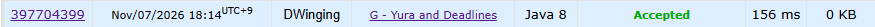

### Codeforces 1900 [Yura and Deadlines](https://codeforces.com/problemset/problem/2244/G) (Java)

> **문제 번호:** 2244G  
> **날짜:** 2026년 11월 07일  
> **알고리즘:** DP  
> **언어:** Java  
> **핵심 키워드:** DP, 펜윅트리

## 📌 문제 개요

- 각 테스트 케이스에는 순서가 정해진 `n`개의 과제가 있고, `i`번째 과제의 점수는 `a_i`이다.
- 선택한 서로 다른 두 과제 `i`, `j`는 `|i-j| > max(a_i, a_j)`를 만족해야 한다.
- 조건을 만족하도록 과제를 골랐을 때 얻을 수 있는 점수 합의 최댓값을 각 테스트 케이스마다 구한다.

---

## 💡 풀이 핵심 (Core Logic)

### 1. 마지막으로 선택한 과제를 기준으로 DP 정의

`dp[i]`를 `i`번째 과제를 마지막으로 선택했을 때의 최대 점수로 둔다. 직전에 선택한 과제가 `j < i`라면 두 과제의 거리 조건을 만족하기 위해 `j + a_j + 1 <= i`와 `j <= i - a_i - 1`이 모두 필요하다. 따라서 이 두 조건을 만족하는 `dp[j]`의 최댓값에 `a_i`를 더한다.

### 2. 사용할 수 있게 된 이전 DP 값만 펜윅 트리에 반영

과제 `j`의 `dp[j]`는 `j + a_j + 1`번째 위치부터 첫 번째 거리 조건을 만족한다. 코드는 이 시점을 `head`와 `next`로 묶어 두고, 해당 위치를 처리할 때 `update`로 펜윅 트리에 넣는다. 이렇게 하면 아직 `i`와 함께 선택할 수 없는 과제는 최댓값 조회에서 제외된다.

### 3. 인덱스 제한까지의 최댓값 조회

현재 과제 `i`에 대해 `limit = i - a_i - 1`을 구하고, `query(tree, limit)`로 두 번째 거리 조건까지 만족하는 이전 `dp`의 최댓값을 얻는다. 여기에 `a_i`를 더해 `dp[i]`를 계산하고, 모든 `dp[i]` 중 최댓값을 답으로 기록한다. 조건에 맞는 이전 과제가 없으면 조회 결과 `0`을 사용한다.

### 시간 복잡도

각 과제를 한 번 처리하며 펜윅 트리의 갱신과 조회가 각각 `O(log n)`이므로 테스트 케이스당 `O(n log n)`이다. 배열과 펜윅 트리에 `O(n)` 공간을 사용한다.

- `n`: 해당 테스트 케이스의 과제 수

---

## 🧠 회고 및 결론

1900 DP는 역시 어렵다. 문제 발생이 어려운건 아닌데 펜윅 트리를 활용하는 것이 까다로웠다.

---

### 📂 소스 코드

[Solution.java](./Solution.java)

---

### 🖥️ 실행 결과

---
