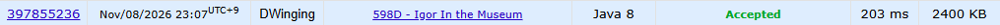

### Codeforces 1700 [Igor In the Museum](https://codeforces.com/problemset/problem/598/D) (Java)

> **문제 번호:** 598D  
> **날짜:** 2026년 11월 08일  
> **알고리즘:** 그래프 탐색, BFS, DP  
> **언어:** Java  
> **핵심 키워드:** BFS, 메모이제이션

## 📌 문제 개요

- 박물관은 `n × m` 격자이며, `.`은 빈 칸이고 `*`은 지나갈 수 없는 칸이다.
- 빈 칸과 막힌 칸이 변을 공유하면 그 사이의 벽에 그림이 하나 있다.
- 시작점에서 상하좌우로 연결된 빈 칸들을 이동하며 인접한 그림을 볼 수 있다.
- `k`개의 질의가 각각 빈 칸의 시작 위치를 지정한다.
- 각 시작점에서 볼 수 있는 그림의 개수를 구한다.

---

## 💡 풀이 핵심 (Core Logic)

### 1. 격자 상태와 연결 영역의 결과 구분

입력을 읽으며 막힌 칸은 `-1`, 아직 탐색하지 않은 빈 칸은 `0`으로 저장한다. 질의마다 시작 칸을 확인하고, 이미 양수로 표시된 칸이라면 그 값에 해당하는 `cnt`의 결과를 바로 반환한다. 같은 연결 영역을 다시 탐색하지 않기 위해서다.

### 2. BFS로 영역의 그림 수 계산

처음 만난 영역은 시작 칸부터 BFS로 탐색한다. 빈 칸을 큐에 넣을 때 현재 질의 번호로 표시해 중복 방문을 막는다. 각 칸의 상하좌우를 확인하여 이웃이 막힌 칸일 때마다 그림 수를 하나씩 더한다. 그림은 빈 칸과 막힌 칸이 맞닿은 변마다 하나씩 있으므로, 영역 전체에서 센 값이 그 영역의 답이다.

### 3. 영역의 답을 저장해 후속 질의에 재사용

BFS가 끝나면 계산한 그림 수를 `cnt[현재 질의 번호]`에 저장한다. 탐색한 모든 빈 칸에 같은 번호가 기록되어 있으므로, 이후 그 영역의 어느 칸에서 시작해도 저장된 답을 즉시 조회할 수 있다.

### 시간 복잡도

격자 초기화에 `O(nm)`, 각 빈 칸을 최대 한 번씩 탐색하는 BFS 전체에 `O(nm)`, 질의 처리에 `O(k)`가 걸려 총 `O(nm + k)`이다. 격자와 BFS 큐에 최대 `O(nm)`, 결과 배열에 `O(k)` 공간을 사용한다.

- `n`, `m`: 격자의 행과 열 수
- `k`: 질의 수

---

## 🧠 회고 및 결론

가벼운 문제다. 결국에 탐색 과정에서 벽을 몇번 마주치는지 구하는 것이 핵심이다. 메모이제이션 기법을 활용하면 중복 탐색을 줄일 수 있다.

---

### 📂 소스 코드

[Solution.java](./Solution.java)

---

### 🖥️ 실행 결과

---
