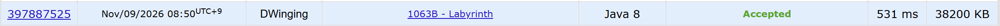

### Codeforces 1800 [Labyrinth](https://codeforces.com/problemset/problem/1063/B) (Java)

> **문제 번호:** 1063B  
> **날짜:** 2026년 11월 09일  
> **알고리즘:** 0-1BFS, 그래프 탐색  
> **언어:** Java  
> **핵심 키워드:** 0-1BFS

## 📌 문제 개요

- `n × m` 미로에서 `.`은 이동할 수 있는 칸이고 `*`은 장애물이다.
- 시작 칸에서 상하좌우로 인접한 빈 칸으로 이동할 수 있다.
- 왼쪽 이동은 최대 `x`번, 오른쪽 이동은 최대 `y`번 할 수 있다.
- 위아래 이동 횟수에는 제한이 없다.
- 시작 칸을 포함하여 도달할 수 있는 칸의 수를 구한다.

---

## 💡 풀이 핵심 (Core Logic)

### 1. 남은 좌우 이동 횟수로 탐색 상태 구성

시작 칸과 왼쪽·오른쪽 이동 가능 횟수를 덱에 넣는다. 각 칸의 `visited`에는 그 칸에 도달했을 때 남은 좌우 이동 횟수의 합을 저장하고, 아직 방문하지 않은 칸은 `-1`로 둔다. 같은 칸에서는 시작 열과 현재 열의 차이로 좌우 이동 횟수의 차이가 정해지므로, 남은 횟수의 합이 클수록 이후 이동에 더 유리하다.

### 2. 덱으로 이동 비용에 따른 탐색 순서 유지

상하 이동은 좌우 이동 가능 횟수를 쓰지 않으므로 덱 앞에 넣고, 왼쪽·오른쪽 이동은 해당 횟수를 하나 소비하므로 뒤에 넣는다. 다음 칸이 미로 안의 빈 칸이고 남은 횟수가 음수가 아니며, 기존 기록보다 남은 횟수의 합이 클 때만 갱신한다. 더 좋은 상태가 이미 기록된 오래된 덱 원소는 건너뛰어 불필요한 확장을 막는다.

### 3. 처음 도달한 칸만 결과에 포함

시작 칸을 결과에 포함한 뒤, `visited`가 `-1`인 칸에 처음 도달할 때만 결과를 하나 늘린다. 이후 더 유리한 경로로 같은 칸을 다시 방문하더라도 칸의 수가 중복 계산되지 않도록 한다.

### 시간 복잡도

격자와 `visited` 배열을 초기화하고, 덱으로 각 칸의 인접한 네 칸을 탐색하므로 시간 복잡도는 `O(nm)`이다. 격자, `visited`, 덱에 `O(nm)` 공간을 사용한다.

- `n`, `m`: 미로의 행과 열 수

---

## 🧠 회고 및 결론

같은 칸에 도달하면 시작 열과 현재 열의 차이로 좌우 이동 횟수의 차이가 고정된다. 따라서 남은 좌우 이동 횟수의 합만 비교해도 더 유리한 탐색 상태를 판단할 수 있다.

---

### 📂 소스 코드

[Solution.java](./Solution.java)

---

### 🖥️ 실행 결과

---
