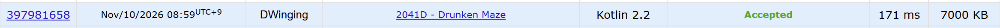

### Codeforces 1700 [Drunken Maze](https://codeforces.com/problemset/problem/2041/D) (Kotlin)

> **문제 번호:** 2041D  
> **날짜:** 2026년 11월 10일  
> **알고리즘:** 그래프 탐색, BFS  
> **언어:** Kotlin  
> **핵심 키워드:** BFS

## 📌 문제 개요

- `n × m` 미로에는 벽 `#`, 빈 칸 `.`, 시작점 `S`, 도착점 `T`가 있다.
- 한 번에 상하좌우로 인접한 칸 하나로 이동하며 벽은 통과할 수 없다.
- 같은 방향으로 연속해서 네 번 이상 이동할 수 없다.
- 시작점에서 도착점까지 이동하는 최소 횟수를 구하고, 도달할 수 없으면 `-1`을 출력한다.

---

## 💡 풀이 핵심 (Core Logic)

### 1. 시작점과 탐색 상태 준비

미로를 읽은 뒤 `findStart`로 `S`의 위치를 찾는다. BFS 큐에는 현재 위치, 직전 이동 방향, 같은 방향으로 연속 이동한 횟수, 지금까지의 이동 횟수를 함께 저장한다. 위치만으로는 다음 이동이 가능한지 판단할 수 없기 때문이다. 시작 상태는 직전 방향을 `-1`, 연속 횟수와 이동 횟수를 `0`으로 둔다.

### 2. 방향별 연속 이동 횟수를 제한하며 확장

현재 칸에서 네 방향을 확인하고, 직전 방향과 같으면 연속 횟수를 하나 늘리고 다르면 `1`로 다시 시작한다. `visited[y][x][dir]`는 해당 칸에 그 방향으로 도착했을 때 기록한 최소 연속 횟수이며, 초기값 `4`를 사용한다. 다음 칸이 벽이 아니고 새 연속 횟수가 기록값보다 작을 때만 큐에 넣고 갱신한다. 따라서 네 번째 연속 이동은 제외하면서, 같은 칸과 방향에 더 적은 연속 횟수로 도착한 상태는 이후 이동 가능성이 더 크므로 다시 탐색한다.

### 3. BFS 순서로 최소 이동 횟수 반환

각 이동의 비용이 한 번으로 같으므로 큐에서 꺼낸 상태가 `T`이면 그 상태의 총 이동 횟수를 반환한다. 큐가 빌 때까지 도착하지 못하면 `-1`을 반환한다.

### 시간 복잡도

각 칸과 도착 방향의 `visited` 값은 `4`에서 `1`~`3`으로 최대 세 번 감소하고, 큐에서 꺼낼 때 네 방향만 확인한다. 시간 복잡도와 공간 복잡도는 모두 `O(nm)`이다.

- `n`, `m`: 미로의 행과 열 수

---

## 🧠 회고 및 결론

간단한 문제다. 3차원 방문 배열을 사용해서 방향 체크만 해주면 된다. visited의 초기값을 4로 두는 것은 센스의 영역

---

### 📂 소스 코드

[Solution.kt](./Solution.kt)

---

### 🖥️ 실행 결과

---
