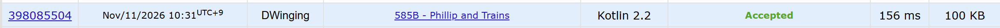

### Codeforces 1700 [Phillip and Trains](https://codeforces.com/problemset/problem/585/B) (Kotlin)

> **문제 번호:** 585B  
> **날짜:** 2026년 11월 11일  
> **알고리즘:** BFS, 그래프 탐색  
> **언어:** Kotlin  
> **핵심 키워드:** BFS

## 📌 문제 개요

- 터널은 3행 `n`열이며, 주인공은 맨 왼쪽 열의 `s`에서 출발한다.
- 주인공은 매 턴 오른쪽으로 한 칸 이동한 뒤 같은 행에 머물거나 위아래로 한 행 이동할 수 있다.
- 그다음 열차는 모두 왼쪽으로 두 칸 이동하며, 이동 중 주인공과 겹치면 실패한다.
- 각 테스트 케이스에서 주인공이 터널의 오른쪽 끝에 도달할 수 있는지 판별한다.

---

## 💡 풀이 핵심 (Core Logic)

### 1. 시작 위치와 방문 상태 준비

입력된 세 행의 첫 열에서 `s`가 있는 행을 찾아 BFS를 시작한다. 큐에는 현재 행과 열을 저장하고, `visited[행][열]`로 같은 위치를 다시 탐색하지 않는다. 열차와 주인공의 이동 속도가 정해져 있으므로 현재 열로 진행 정도를 나타낸다.

### 2. 한 턴에 필요한 칸 검사

현재 열 `cx`에서 오른쪽 칸이 막혀 있으면 먼저 이동할 수 없으므로 해당 상태를 건너뛴다. 이동할 행은 현재 행과 위아래 인접 행 중에서 고른다. `checkTrain`으로 후보 행의 `cx + 1`부터 세 칸이 비어 있는지 확인한다. 이 구간에 열차가 있으면 주인공이 행을 바꾸거나 열차가 왼쪽으로 이동하는 동안 충돌할 수 있기 때문이다.

### 3. 다음 상태를 탐색하고 결과 반환

안전한 후보는 열을 `cx + 3`으로 옮겨 큐에 넣는다. 이는 한 턴 동안 주인공이 오른쪽으로 한 칸, 열차가 왼쪽으로 두 칸 이동하는 상대적인 변화를 반영한다. 오른쪽으로 이동하거나 다음 열을 계산했을 때 범위 밖이면 `YES`를 반환하고, 탐색 가능한 상태가 모두 사라지면 `NO`를 반환한다.

### 시간 복잡도

각 행과 열의 상태는 최대 한 번 큐에 들어가며, 상태마다 최대 세 행에 대해 길이 3의 구간을 검사한다. 시간 복잡도와 공간 복잡도는 모두 `O(n)`이다.

- `n`: 터널의 열 수

---

## 🧠 회고 및 결론

그냥 무난하게 풀기 좋은 시뮬레이션 문제다.

---

### 📂 소스 코드

[Solution.kt](./Solution.kt)

---

### 🖥️ 실행 결과

---
