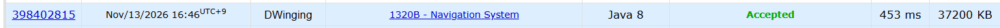

### Codeforces 1700 [Navigation System](https://codeforces.com/problemset/problem/1320/B) (Java)

> **문제 번호:** 1320B  
> **날짜:** 2026년 11월 13일  
> **알고리즘:** BFS, 그래프 탐색  
> **언어:** Java  
> **핵심 키워드:** BFS

## 📌 문제 개요

- 교차로 `n`개가 `m`개의 단방향 도로로 연결되어 있다.
- 출발지에서 목적지까지 실제로 이동한 경로가 주어지며, 같은 교차로를 두 번 방문하지 않는다.
- 내비게이션은 현재 교차로에서 목적지로 가는 최단 경로 하나를 안내하고, 안내와 다른 도로로 이동하면 경로를 다시 만든다.
- 가능한 안내 경로 선택에 따라 발생할 수 있는 재탐색 횟수의 최솟값과 최댓값을 구한다.

---

## 💡 풀이 핵심 (Core Logic)

### 1. 도로를 역방향으로 저장

입력 도로 `u → v`를 `v`의 목록에 `u`로 저장한다. 목적지에서 BFS를 시작해 각 교차로에서 목적지까지 남은 최단 거리를 한 번에 구하기 위해서다.

### 2. BFS로 거리와 최단 경로의 다음 선택지 수 계산

경로의 마지막 교차로를 거리 0으로 두고 BFS를 수행한다. 역방향 이웃을 더 짧은 거리로 처음 발견하면 거리와 선택지 수를 갱신하고, 같은 최단 거리로 다시 발견하면 선택지 수를 늘린다. 따라서 `dist[v][0]`은 목적지까지의 최단 거리, `dist[v][1]`은 `v`에서 고를 수 있는 최단 경로의 다음 교차로 수가 된다.

### 3. 실제 경로의 각 이동을 판정

실제 이동 `v → next`가 최단 거리 값을 1 줄이지 않으면 어떤 안내 경로를 골라도 재탐색이 필요하므로 최솟값과 최댓값을 모두 올린다. 최단 거리로 이동했더라도 `v`에서 가능한 다음 교차로가 둘 이상이면 내비게이션이 다른 길을 안내할 수 있으므로 최댓값만 올린다.

### 시간 복잡도

역방향 그래프를 만들고 BFS로 모든 도로를 확인한 뒤 실제 경로를 한 번 순회하므로 시간 복잡도는 `O(n + m + k)`이고, 그래프·거리 배열·경로를 저장하는 공간 복잡도도 `O(n + m + k)`이다.

- `n`: 교차로 수
- `m`: 도로 수
- `k`: 실제 경로에 포함된 교차로 수

---

## 🧠 회고 및 결론

역방향 그래프를 만들고, 최단 거리의 도로 개수가 중요한 문제였다.

---

### 📂 소스 코드

[Solution.java](./Solution.java)

---

### 🖥️ 실행 결과

---
