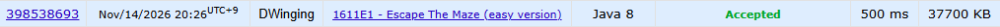

### Codeforces 1700 [Escape The Maze (easy version)](https://codeforces.com/problemset/problem/1611/E1) (Java)

> **문제 번호:** 1611E1  
> **날짜:** 2026년 11월 14일  
> **알고리즘:** BFS, 트리  
> **언어:** Java  
> **핵심 키워드:** 트리, 멀티 소스 BFS

## 📌 문제 개요

- `n`개의 방과 `n-1`개의 양방향 통로가 트리를 이룬다.
- 블라드는 1번 방에서, `k`명의 친구는 서로 다른 방에서 출발한다.
- 모든 참가자는 한 시간에 통로 하나를 지나거나 제자리에 머무를 수 있다.
- 블라드가 승리하기 전에 친구와 같은 방이나 통로에서 만나면 친구가 이긴다.
- 블라드가 1번 방이 아닌 말단 방에 먼저 도달하면 승리한다.
- 친구들이 어떻게 움직이든 블라드가 승리를 보장할 수 있는지 판별한다.

---

## 💡 풀이 핵심 (Core Logic)

### 1. 친구들과 블라드를 하나의 BFS 큐에 배치

친구들의 시작 방을 모두 `flag = -1`로 큐에 넣은 뒤, 1번 방을 `flag = 1`로 넣는다. 시작 방들은 곧바로 방문 처리한다. 친구들을 먼저 넣어 같은 시간에 도달할 수 있는 방은 친구 쪽에서 먼저 차지하도록 한다.

### 2. 공유 방문 배열로 이동 가능 영역 구분

큐에서 방과 `flag`를 꺼내 아직 방문하지 않은 인접 방으로 같은 `flag`를 전달한다. BFS는 거리 순서로 진행되고 같은 거리에서는 친구가 앞서므로, 블라드는 친구가 자신보다 빠르거나 동시에 도달할 수 있는 방으로 확장하지 않는다.

### 3. 블라드가 말단 방에 도달하는지 판별

블라드의 다음 방이 아직 방문되지 않았고 연결된 통로가 하나뿐이면 즉시 `true`를 반환한다. 친구에게 선점되지 않은 탈출 방을 찾은 것이다. 큐가 빌 때까지 찾지 못하면 `false`를 반환한다.

### 시간 복잡도

각 방과 통로를 BFS에서 상수 번 확인하므로 테스트 케이스당 시간과 공간 복잡도는 모두 `O(n)`이다.

- `n`: 방의 수

---

## 🧠 회고 및 결론

간단한 멀티 소스 BFS 문제다. 트리의 특징을 많이 활용하는 문제는 아니었다.

---

### 📂 소스 코드

[Solution.java](./Solution.java)

---

### 🖥️ 실행 결과

---
