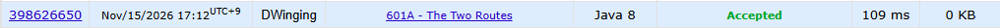

### Codeforces 1600 [The Two Routes](https://codeforces.com/problemset/problem/601/A) (Java)

> **문제 번호:** 601A  
> **날짜:** 2026년 11월 15일  
> **알고리즘:** BFS, 최단 거리  
> **언어:** Java  
> **핵심 키워드:** BFS, 문제 해석

## 📌 문제 개요

- `n`개의 마을 사이에 `m`개의 양방향 철도가 주어진다.
- 서로 다른 두 마을 사이에 철도가 없을 때에만 도로가 있다.
- 기차는 철도만, 버스는 도로만 이용해 1번 마을에서 `n`번 마을로 이동한다.
- 두 교통수단은 동시에 출발하며, 간선 하나를 지나는 데 1시간이 걸린다.
- 목적지 외의 같은 마을에 동시에 도착해서는 안 된다.
- 두 교통수단이 모두 도착하는 최소 시간, 또는 도착할 수 없을 때 `-1`을 구한다.

---

## 💡 풀이 핵심 (Core Logic)

### 1. 철도 연결을 인접 행렬에 기록

입력된 철도를 `railway[u][v]`와 `railway[v][u]`에 표시한다. 도로는 철도가 없는 서로 다른 두 마을을 잇기 때문에, 별도 도로 그래프를 만들지 않고 같은 행렬의 `false` 값으로 판별할 수 있다.

### 2. 직접 연결되지 않은 교통수단을 선택

`railway[1][n]`이 참이면 기차가, 거짓이면 버스가 목적지에 1시간 만에 도착할 수 있다. 이 직행 경로에는 중간 마을이 없으므로 나머지 교통수단의 최단 이동 시간만 구하면 된다. 코드는 `flag = !railway[1][n]`으로 탐색할 간선 종류를 정한다. `flag`가 참이면 철도, 거짓이면 도로를 탐색한다.

### 3. 선택한 경로에서 BFS로 최단 시간 계산

1번 마을에서 BFS를 시작하고, 현재 마을과 다른 모든 마을을 확인해 `railway[cur][next] == flag`인 미방문 마을만 큐에 넣는다. `visited`에는 시작점을 1로 둔 탐색 깊이를 저장하므로, `n`번 마을에 처음 도착했을 때 `visited[n] - 1`이 걸린 시간이다. 끝까지 도착하지 못하면 `-1`을 반환한다.

### 시간 복잡도

인접 행렬을 만들고 각 마을에서 최대 `n`개 후보를 살피므로 시간 복잡도는 `O(n² + m) = O(n²)`이다. 인접 행렬 때문에 공간 복잡도는 `O(n²)`이다.

- `n`: 마을 수
- `m`: 철도 수

---

## 🧠 회고 및 결론

풀이는 간단한데, 문제 해석이 조금 난해한 문제다. 다시 풀면 쉽게 풀지도...

---

### 📂 소스 코드

[Solution.java](./Solution.java)

---

### 🖥️ 실행 결과

---
