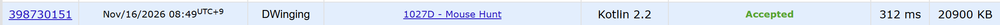

### Codeforces 1700 [Mouse Hunt](https://codeforces.com/problemset/problem/1027/D) (Kotlin)

> **문제 번호:** 1027D  
> **날짜:** 2026년 11월 16일  
> **알고리즘:** 그래프 탐색, DSU  
> **언어:** Kotlin  
> **핵심 키워드:** 사이클 판별

## 📌 문제 개요

- `n`개의 방마다 쥐덫을 설치하는 비용이 주어진다.
- 쥐는 매초 현재 방 `i`에서 지정된 방 `a_i`로 이동하며, 같은 방에 머물 수도 있다.
- 쥐의 시작 방은 알려지지 않아 어느 방에서 시작해도 결국 쥐덫에 걸려야 한다.
- 이를 보장하는 쥐덫 설치 비용의 최솟값을 구한다.

---

## 💡 풀이 핵심 (Core Logic)

### 1. 출발점별로 이동 경로를 추적한다

아직 방문하지 않은 방에서 `checkCycle`을 호출하고, `next`를 따라 이동하면서 `visited`에 해당 출발점의 표식을 남긴다. 이미 확인한 경로를 다시 따라가지 않으면서 새 사이클을 찾기 위해서다.

### 2. 현재 경로에서 처음 만난 사이클만 구분한다

방문한 방에 도달했을 때 표식이 현재 출발점의 것이라면 이번 경로 안에서 사이클이 생긴 것이므로 그 방을 반환한다. 다른 표식이라면 이전에 처리한 경로로 합류한 것이므로 `-1`을 반환해 비용을 중복 계산하지 않는다.

### 3. 사이클마다 최소 설치 비용을 더한다

새로 발견한 사이클의 시작 방에서 `getMinCost`가 `next`를 따라 한 바퀴 돌며 최소 비용을 구한다. 어느 방에서 출발하든 결국 사이클에 들어가므로, 각 사이클에 최소 비용의 쥐덫 하나씩을 설치하는 비용을 합산한다.

### 시간 복잡도

각 방은 경로 추적에서 한 번 방문되고, 발견한 사이클의 방은 최소 비용 계산에서 한 번 더 확인하므로 시간 복잡도는 `O(n)`이다. `cost`, `next`, `visited` 배열의 공간 복잡도는 `O(n)`이다.

- `n`: 방의 수

---

## 🧠 회고 및 결론

쉽게 보면 사이클 판별 문제다.

---

### 📂 소스 코드

[Solution.kt](./Solution.kt)

---

### 🖥️ 실행 결과

---
