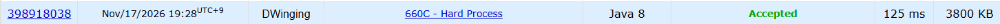

### Codeforces 1600 [Hard Process](https://codeforces.com/problemset/problem/660/C) (Java)

> **문제 번호:** 660C  
> **날짜:** 2026년 11월 17일  
> **알고리즘:** 두 포인터  
> **언어:** Java  
> **핵심 키워드:** 두 포인터

## 📌 문제 개요

- 길이 `n`의 배열은 0과 1로 이루어진다.
- 0을 최대 `k`개까지 1로 바꿀 수 있다.
- 변경 후 연속된 1의 구간 길이를 최대화한다.
- 그 최대 길이와 변경된 배열을 출력한다.

---

## 💡 풀이 핵심 (Core Logic)

### 1. 허용할 수 있는 0의 위치를 관리한다

배열을 왼쪽부터 순회하면서 0의 인덱스를 큐에 담는다. 새 0을 포함하면 큐에 담긴 0이 `k`개를 넘는 경우 가장 앞의 0을 꺼내고 구간 시작점 `start`를 그 다음으로 옮긴다. 이렇게 해야 현재 구간 안에서 바꿔야 하는 0의 수가 `k` 이하로 유지된다. `k`가 0이면 0을 만날 때마다 시작점을 그 다음으로 옮긴다.

### 2. 가장 긴 구간의 경계를 저장한다

각 위치 `i`에서 유효한 구간 길이 `i - start + 1`을 확인하고, 기존 최댓값보다 길면 길이와 양 끝 인덱스를 갱신한다. 이후 배열을 실제로 변경할 구간을 기억하기 위해서다.

### 3. 선택한 구간을 1로 바꾸어 출력한다

기록한 구간의 모든 원소를 1로 바꾼다. 이 구간에는 0이 최대 `k`개 있으므로 변경 횟수 제한을 지키면서 저장한 최대 길이를 만들 수 있다. 최댓값과 변경된 배열을 차례로 출력한다.

### 시간 복잡도

각 인덱스를 한 번 순회하고 0의 위치는 큐에 최대 한 번씩 들어갔다 나오므로 시간 복잡도는 `O(n)`이다. 배열과 큐, 출력 문자열에 `O(n)` 공간을 사용한다.

- `n`: 배열의 길이

---

## 🧠 회고 및 결론

가장 긴 구간의 경계를 저장하고, 큐를 활용하여 후보군을 관리하는 것이 핵심이라고 생각한다.

---

### 📂 소스 코드

[Solution.java](./Solution.java)

---

### 🖥️ 실행 결과

---
