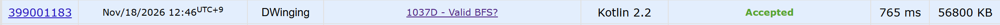

### Codeforces 1700 [Valid BFS?](https://codeforces.com/problemset/problem/1037/D) (Kotlin)

> **문제 번호:** 1037D  
> **날짜:** 2026년 11월 18일  
> **알고리즘:** 트리, BFS  
> **언어:** Kotlin  
> **핵심 키워드:** BFS 탐색 순서 검증, 부모-자식 관계

## 📌 문제 개요

- `n`개의 정점으로 이루어진 무방향 트리가 주어진다.
- 1번 정점에서 시작하는 BFS 탐색 순서가 주어진다.
- 인접 정점의 탐색 순서는 자유롭게 선택할 수 있다.
- 주어진 수열이 유효한 BFS 탐색 순서인지 판별한다.

---

## 💡 풀이 핵심 (Core Logic)

### 1. BFS 탐색 순서의 조건

BFS는 큐를 이용하므로 같은 깊이에 속한 정점들이 연속해서 등장한다. 하지만 **깊이가 같다는 사실만으로 올바른 BFS 순서라고 판단할 수는 없다.**

부모 정점을 방문하면 아직 방문하지 않은 모든 자식 정점을 큐에 삽입한다. 따라서 한 부모의 자식들은 연속해서 등장해야 하며, 부모들의 탐색 순서에 따라 자식 그룹의 순서도 결정된다.

즉, 각 부모 정점의 자식들이 주어진 수열에서 하나의 연속된 구간을 구성하는지 확인해야 한다.

### 2. BFS와 탐색 순서 검증

별도의 트리 전처리 없이 BFS를 수행하면서 주어진 수열을 검증한다.

1. 루트 정점 1을 큐에 삽입하고, 수열의 첫 번째 원소가 1인지 확인한다.
2. 큐에서 현재 정점 `cur`를 꺼낸다.
3. `cur`의 모든 인접 정점을 `visited`에 표시한다.
4. 현재 정점의 자식 수만큼 수열에서 정점을 가져온다.
5. 가져온 정점이 `visited`에 표시되지 않았다면 `No`를 반환한다.
6. 검증을 통과한 정점은 수열에 등장한 순서대로 큐에 삽입한다.

트리에서 루트를 제외한 각 정점의 인접 정점 중 하나는 부모이므로, 자식 수는 `arr[cur].size - 1`이다.

루트에도 동일한 계산을 적용하기 위해 가상의 부모 정점 `0`을 추가한다.

여기서 `visited`는 단순한 방문 기록뿐 아니라 **현재 부모의 자식으로 등장할 수 있는 정점을 확인하는 용도**로 사용한다.

수열에 중복 정점이 없고, 이전 부모의 자식들은 이미 검증되어 소비되었으므로 현재 검사 구간에서 `visited`가 참인 정점은 현재 부모의 자식이어야 한다.

### 3. 검증 결과

모든 부모 정점에 대해 자식 구간이 유효하다면 `Yes`를 반환한다.

이 방식은 각 부모의 자식 사이에서는 임의의 순서를 허용하면서도, 서로 다른 부모의 자식들이 잘못된 순서로 등장하는 경우를 차단한다.

### 시간 복잡도

- **시간:** `O(n)` — 각 정점을 한 번씩 큐에서 꺼내고, 트리의 인접 리스트와 주어진 수열을 선형으로 탐색한다.
- **공간:** `O(n)` — 인접 리스트, 방문 배열, 탐색 수열 및 큐를 사용한다.

---

## 🧠 회고 및 결론

부모 자식 관계를 정의하고, BFS 순서를 검증하는 것이 핵심이다.

---

### 📂 소스 코드

[Solution.kt](./Solution.kt)

---

### 🖥️ 실행 결과

---
