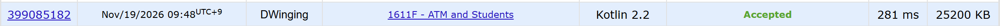

### Codeforces 1800 [ATM and Students](https://codeforces.com/problemset/problem/1611/F) (Kotlin)

> **문제 번호:** 1611F  
> **날짜:** 2026년 11월 19일  
> **알고리즘:** 두 포인터  
> **언어:** Kotlin  
> **핵심 키워드:** 두 포인터

## 📌 문제 개요

- 초기 잔액이 `s`인 ATM과 순서대로 줄을 선 `n`명의 학생이 주어진다.
- 각 학생의 거래 금액 `a_i`가 양수이면 입금하고, 음수이면 그 절댓값만큼 출금한다.
- 임의의 학생부터 서비스를 시작할 수 있으며, 학생들은 줄의 순서대로 연속해서 처리한다.
- 출금할 돈이 부족하면 해당 학생을 처리하지 못하고 서비스를 종료한다.
- 가장 많은 학생을 처리할 수 있는 연속 구간의 시작·끝 번호를 출력하고, 아무도 처리할 수 없다면 `-1`을 출력한다.

---

## 💡 풀이 핵심 (Core Logic)

### 1. 현재 구간의 잔액 관리

`solve`는 왼쪽 경계 `idx`와 오른쪽 경계 `end`로 처리할 학생 구간을 관리한다. `sum`을 초기 잔액 `s`로 시작하고, 오른쪽 경계를 확장할 때 `arr[end]`를 더해 현재 구간을 처리한 뒤의 잔액을 계산한다.

여러 학생의 거래 금액이 누적되므로 배열과 잔액은 `Long`으로 관리한다. 빈 구간의 잔액은 초기 금액 `s`이다.

### 2. 잔액이 부족하면 시작 위치 이동

새 학생을 포함한 뒤 `sum < 0`이면 현재 시작 위치에서는 그 학생까지 처리할 수 없다. 뒤에 입금하는 학생이 있더라도 현재 학생을 먼저 처리해야 하므로, 같은 시작 위치를 유지한 채 구간을 더 늘릴 수는 없다.

따라서 `sum`에서 `arr[idx]`를 빼고 `idx`를 증가시켜 앞쪽 학생을 제외한다. 잔액이 다시 음수가 아니게 되거나 구간이 빌 때까지 이 처리를 반복한다. 이때 `sum`은 새 시작 위치에서도 초기 금액 `s`를 기준으로 계산한 잔액을 나타낸다.

이전 구간은 모든 학생을 순서대로 처리할 수 있는 상태였다. 잔액 부족을 해소할 때까지 제외한 앞부분의 거래 합은 음수이므로, 남은 학생들의 기존 처리 시점 잔액도 줄어들지 않는다. 따라서 왼쪽 경계를 옮긴 뒤에도 구간 전체를 처리할 수 있다.

### 3. 최장 구간 기록과 결과 반환

잔액이 음수가 아니고 현재 길이 `end - idx + 1`이 `res`보다 클 때만 정답을 갱신한다. 문제의 학생 번호는 1부터 시작하므로 `idx + 1`, `end + 1`을 저장한다.

같은 길이의 구간은 기존 답을 유지한다. 모든 학생을 확인한 뒤 `res`가 0이면 `-1`을 반환하고, 그렇지 않으면 저장한 시작·끝 번호를 반환한다. `main`은 각 테스트 케이스의 결과를 모아 출력한다.

### 시간 복잡도

- **시간:** 테스트 케이스당 `O(n)` — 오른쪽 경계와 왼쪽 경계가 각각 최대 `n`번 전진한다.
- **공간:** 테스트 케이스당 `O(n)` — 거래 금액 배열을 저장한다. `solve` 함수의 추가 공간은 `O(1)`이며, `main`은 전체 테스트 케이스의 출력 문자열을 별도로 보관한다.
- `n`: 한 테스트 케이스의 학생 수

---

## 🧠 회고 및 결론

익숙한 패턴의 간단한 문제다. 오버플로만 방지해주면 된다.

---

### 📂 소스 코드

[Solution.kt](./Solution.kt)

---

### 🖥️ 실행 결과

---
