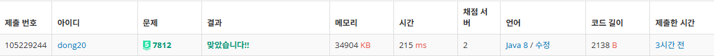

### BaekJoon Platinum Ⅴ [중앙 트리](https://acmicpc.net/problem/7812) (Java)

> **문제 번호:** 7812 <br>
> **날짜:** 2026년 11월 21일 <br>
> **알고리즘:** 트리, 트리에서의 DP <br>
> **언어:** Java <br>
> **핵심 키워드:** 트리에서의 DP

## 📌 문제 개요

- 여러 테스트 케이스가 주어지며, 정점 수 `n`이 `0`이면 입력이 끝난다.
- 각 트리는 정점 `n`개와 간선 `n - 1`개로 이루어지며, `1 ≤ n ≤ 10,000`이다.
- 정점 번호는 `0`부터 `n - 1`까지이며, 각 간선의 가중치 `w`는 `1 ≤ w ≤ 100`이다.
- 두 정점 사이의 이동 비용은 두 정점을 잇는 경로의 간선 가중치 합이다.
- 중앙 정점은 다른 모든 정점까지의 이동 비용 합이 최소인 정점이다.
- 각 테스트 케이스에서 중앙 정점과 모든 정점 사이의 이동 비용 합을 출력한다.

---

## 💡 풀이 핵심 (Core Logic)

### 1. 서브트리 크기와 최초 루트의 거리 합 계산

간선을 양방향 인접 리스트에 저장한 뒤, `settingTree`로 정점 `0`을 루트로 하는 DFS를 수행한다. 부모 정점으로 돌아가는 간선은 건너뛰어 트리를 한 번 순회한다.

`size[cur]`는 자신을 포함한 서브트리의 정점 수이고, 이 단계의 `dp[cur]`는 `cur`에서 자신의 서브트리 정점들까지의 거리 합이다. 자식의 계산이 끝나면 다음 값을 누적한다.

```text
size[cur] += size[child]
dp[cur] += dp[child] + w * size[child]
```

부모에서 자식 서브트리의 각 정점으로 가려면 가중치 `w`인 간선을 한 번씩 더 지나므로, 자식의 거리 합에 `w * size[child]`를 더한다. 모든 자식의 값을 합치면 `dp[0]`은 정점 `0`에서 트리 전체 정점까지의 거리 합이 된다.

### 2. 루트를 옮기며 전체 거리 합의 최솟값 계산

`res`를 `dp[0]`으로 초기화한 뒤 `solve`로 다시 DFS를 수행한다. 부모 `cur`에서 자식 `child`로 기준 정점을 옮기면, 원래 `child` 서브트리에 속한 `size[child]`개 정점까지의 거리는 각각 `w`만큼 줄고, 나머지 `n - size[child]`개 정점까지의 거리는 각각 `w`만큼 늘어난다.

따라서 부모의 전체 거리 합을 이용해 자식의 전체 거리 합을 상수 시간에 구한다.

```text
dp[child] = dp[cur] + (n - 2 * size[child]) * w
```

이 단계에서는 `dp[child]`를 트리 전체에 대한 거리 합으로 덮어쓰며, `size`는 정점 `0`을 기준으로 계산한 값을 유지한다. 모든 정점에서 `res = min(res, dp[cur])`로 최솟값을 갱신하므로, 정점마다 거리 합을 처음부터 다시 구할 필요가 없다. 거리 합과 가중치 곱셈은 `long`으로 처리하며, 테스트 케이스별 최솟값을 모아 출력한다.

### 시간 복잡도

- **시간:** 테스트 케이스당 `O(n)` — 인접 리스트 구성과 두 번의 DFS에서 정점과 간선을 각각 선형으로 처리한다. 여러 테스트 케이스 전체로는 `O(Σn)`이다.
- **공간:** 테스트 케이스당 `O(n)` — 인접 리스트, `dp`, `size`와 최대 깊이 `n`의 재귀 호출 스택을 사용한다. 전체 출력은 별도의 `StringBuilder`에 누적한다.
- `n`: 한 테스트 케이스의 정점 수
- `w`: 부모와 자식을 잇는 간선의 가중치

---

## 🧠 회고 및 결론

점화식을 잘 세워야하는 문제다. 비슷한 문제를 많이 풀어봤지만, 아직 부족한 것 같다.

---

### 📂 소스 코드

[Solution.java](./Solution.java)

---

### 🖥️ 실행 결과



---
