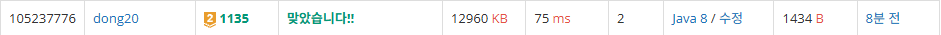

### BaekJoon Gold Ⅱ [뉴스 전하기](https://acmicpc.net/problem/1135) (Java)

> **문제 번호:** 1135  
> **날짜:** 2026년 11월 22일  
> **알고리즘:** 트리, 트리에서의 DP, 정렬, 그리디  
> **언어:** Java  
> **핵심 키워드:** 트리, 정렬, 그리디

## 📌 문제 개요

- 직원 수 `n`과 각 직원의 직속 상사 번호가 주어지며, `1 ≤ n ≤ 50`이다.
- 회사는 `0`번 직원을 루트로 하는 트리 구조이고, `0`번 직원의 상사 번호는 `-1`이다.
- 뉴스를 아는 직원은 자신의 직속 부하에게 한 번에 한 명씩 전화를 걸 수 있으며, 통화에는 정확히 1분이 걸린다.
- 뉴스를 전달받은 직원도 자신의 직속 부하에게 같은 방식으로 뉴스를 전한다.
- `0`번 직원에게서 시작해 모든 직원이 뉴스를 듣기까지 걸리는 시간의 최솟값을 구한다.

---

## 💡 풀이 핵심 (Core Logic)

### 1. 상사에서 직속 부하로 이어지는 트리 구성

`0`번 직원의 상사 번호 `-1`은 읽고 넘기고, 나머지 직원 `i`를 상사 `p`의 인접 리스트 `list[p]`에 추가한다. 뉴스는 상사에서 직속 부하로만 전달되므로 자식 방향만 저장하며, `solve(list, 0)`에서 전체 전파 시간을 계산한다.

### 2. 자식 서브트리의 전파 시간을 재귀로 계산

`solve(list, node)`는 `node`가 뉴스를 알고 있는 시점부터 자신의 모든 하위 직원에게 전달을 마칠 때까지 필요한 최소 시간을 반환한다. 각 자식에 대해 먼저 `solve`를 호출해 결과를 `val`에 저장한다. 자식 아래에서 필요한 시간을 알아야 현재 직원의 연락 순서를 정할 수 있기 때문이다.

직속 부하가 없는 직원은 추가로 전파할 대상이 없다. 이 경우 길이가 `0`인 배열을 처리하고 초기값 `res = 0`을 그대로 반환한다.

### 3. 오래 걸리는 자식부터 연락하고 가장 늦은 완료 시간 선택

`Arrays.sort(val)`로 자식별 시간을 오름차순 정렬한 뒤 뒤에서부터 순회한다. 전파 시간이 긴 자식에게 먼저 연락하면 그 자식이 하위 직원에게 뉴스를 전하는 동안 현재 직원도 다른 자식에게 연락할 수 있다. 긴 전파 시간을 뒤로 미루면 그만큼 완료가 늦어지므로, 시간이 큰 자식부터 처리한다.

현재 직원이 뉴스를 안 시점을 기준으로 첫 번째 자식은 1분 뒤, 두 번째 자식은 2분 뒤에 뉴스를 받는다. 코드에서는 `time`을 `1`부터 증가시키며 `val[i] + time`을 계산한다. 각 자식의 서브트리는 병행해서 전파되므로 완료 시간을 합산하지 않고, 가장 늦게 끝나는 값으로 `res`를 갱신한다. 루트의 반환값이 모든 직원에게 뉴스를 전하는 최소 시간이다.

### 시간 복잡도

- **시간:** `O(n + Σ d(v) log d(v))`, 전체 상한은 `O(n log n)`이다. 각 정점을 한 번 방문하고, 정점마다 자식 수만큼의 배열을 정렬한다. 모든 자식 수의 합은 `n - 1`이다.
- **공간:** `O(n)` — 인접 리스트와 각 호출의 자식별 시간 배열, 최대 깊이 `n`의 재귀 호출 스택을 사용한다.
- `n`: 직원 수
- `d(v)`: 직원 `v`의 직속 부하 수

---

## 🧠 회고 및 결론

간단한 트리 DP 문제다.

---

### 📂 소스 코드

[Solution.java](./Solution.java)

---

### 🖥️ 실행 결과

---
