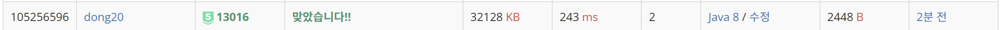

### BaekJoon Platinum Ⅴ [내 왼손에는 흑염룡이 잠들어 있다](https://www.acmicpc.net/problem/13016) (Java)

> **문제 번호:** 13016 <br>
> **날짜:** 2026년 11월 24일 <br>
> **알고리즘:** 트리, 트리에서의 DP <br>
> **언어:** Java <br>
> **핵심 키워드:** 트리에서의 DP

## 📌 문제 개요

- 국가 `N`개가 `N - 1`개의 양방향 도로로 연결되어 있으며, `2 ≤ N ≤ 50,000`이다.
- 임의의 국가에서 다른 모든 국가로 이동할 수 있다.
- 각 도로의 길이는 `1` 이상 `40,000` 이하의 정수이며, 두 국가 사이의 거리는 유일한 경로에 있는 도로 길이의 합이다.
- 각 국가 `i`에서 가장 멀리 떨어진 국가까지의 거리 `D[i]`를 구해 국가 번호 순서대로 한 줄에 하나씩 출력한다.

---

## 💡 풀이 핵심 (Core Logic)

### 1. 자식 방향 최장 거리 두 개 저장

도로를 양방향 인접 리스트 `list`에 저장하고, `settingTree(1, 0)`으로 정점 `1`을 루트로 하는 DFS를 수행한다. 부모로 돌아가는 간선은 건너뛰고, 자식의 계산이 끝난 뒤 `len[child][0] + w`를 현재 정점의 거리 후보로 사용한다.

`len[node][0]`에는 자식 방향으로 내려가는 거리 중 최댓값을, `len[node][1]`에는 서로 다른 자식 방향 후보 중 두 번째 최댓값을 저장한다. `idx[node]`에는 최댓값을 만든 자식을 기록한다. 초기값 `0`은 현재 정점에 머무르는 거리를 나타내므로, 자식이 없거나 대체할 자식 방향이 없어도 처리할 수 있다.

최댓값 하나만 저장하면 다음 DFS에서 그 최댓값을 만든 자식에게 되돌려 전달할 수 있다. 이를 피하기 위해 두 번째 최댓값까지 준비한다. 같은 거리의 후보도 최댓값 갱신에 포함하므로, 서로 다른 자식 방향의 거리가 같을 때도 대체 후보가 유지된다.

### 2. 부모 방향 거리를 전달하며 각 정점의 답 계산

`solve(res, 1, 0, 0)`에서 시작하며, `val`은 현재 정점에서 부모 방향으로 이동해 자신의 서브트리 밖에 도달하는 최장 거리다. 루트에서는 부모 방향이 없으므로 `0`으로 시작한다. 현재 정점의 답은 부모 방향과 자식 방향 중 더 큰 거리다.

```text
res[node] = max(val, len[node][0])
```

자식에게 부모 방향 거리를 전달할 때는 해당 자식의 서브트리로 다시 내려가는 경로를 제외해야 한다. 따라서 최장 거리를 만든 자식인지에 따라 사용할 후보를 선택하고, 자식에서 부모까지의 간선 길이 `w`를 더한다.

```text
idx[node] == child: nextVal = max(val, len[node][1]) + w
그 외:              nextVal = max(val, len[node][0]) + w
```

이렇게 전달한 값은 자식의 관점에서 자신의 서브트리 밖으로 가는 최장 거리가 된다. 모든 정점의 답을 구한 뒤 `buildString`에서 `res[1]`부터 `res[n]`까지 `StringBuilder`에 모아 출력한다.

### 시간 복잡도

- **시간:** `O(n)` — 인접 리스트 구성과 두 번의 DFS에서 각 정점과 간선을 선형으로 처리하고, 결과를 번호 순서대로 출력한다.
- **공간:** `O(n)` — 인접 리스트, 거리 및 결과 배열, 출력 버퍼와 최대 깊이 `n`의 재귀 호출 스택을 사용한다.
- `n`: 국가 수

---

## 🧠 회고 및 결론

트리에서의 DP 이해도를 물어보는 문제였다. 상향 경로를 미리 누적하고, 하향 경로 탐색을 할 때 중복 경로를 사용하지 않도록 배제하는 것이 핵심이었다.

---

### 📂 소스 코드

[Solution.java](./Solution.java)

---

### 🖥️ 실행 결과



---
