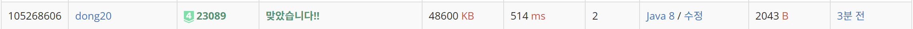

### BaekJoon Platinum Ⅴ [사탕나무](https://www.acmicpc.net/problem/23089) (Java)

> **문제 번호:** 23089 <br>
> **날짜:** 2026년 11월 25일 <br>
> **알고리즘:** 트리, 트리에서의 DP <br>
> **언어:** Java <br>
> **핵심 키워드:** 트리에서의 DP, 점화식

## 📌 문제 개요

- `N`개의 사탕이 `N - 1`개의 간선으로 연결된 트리가 주어지며, `3 ≤ N ≤ 100,000`이다.
- 모든 간선의 길이는 `1`이며, 두 사탕 사이의 최단 경로는 유일하다.
- 기준 사탕 하나를 고르면 그 사탕과의 최단거리가 `K` 이하인 모든 사탕을 먹으며, `1 ≤ K ≤ 20`이다.
- 기준 사탕을 적절히 골랐을 때 먹을 수 있는 사탕 개수의 최댓값을 구한다.

---

## 💡 풀이 핵심 (Core Logic)

### 1. 서브트리의 거리별 사탕 수 계산

간선을 양방향 인접 리스트 `list`에 저장하고, `settingTree(n, k, 1, 0)`으로 정점 `1`을 루트로 하는 DFS를 수행한다. 이 단계에서 `dp[node][i]`는 `node`의 서브트리 안에서 `node`와의 거리가 정확히 `i`인 사탕 수다.

자기 자신을 세기 위해 `dp[node][0] = 1`로 초기화한다. 자식의 계산이 끝나면 다음 점화식으로 거리별 개수를 합친다. 자식에서 거리 `i - 1`인 사탕은 현재 정점에서 거리 `i`이므로, 서로 겹치지 않는 자식 서브트리의 결과를 모을 수 있다.

```text
dp[node][i] += dp[child][i - 1]  (1 ≤ i ≤ k)
```

### 2. 부모 방향의 사탕 수를 더해 전체 트리로 확장

`downTree(n, k, 1, 0)`은 부모를 먼저 처리한 뒤 자식으로 내려간다. 현재 정점 `node`를 갱신할 때 부모 `p`의 DP는 전체 트리를 기준으로 계산되어 있으므로, 부모 쪽을 거쳐 도달하는 사탕 수를 가져올 수 있다.

부모에서 거리 `i - 1`인 사탕 중에는 현재 정점의 서브트리에 속하는 사탕도 포함된다. 이들은 현재 정점에서 거리 `i - 2`인 사탕이므로 해당 개수를 빼야 부모 방향으로 이동해서 도달하는 사탕만 더할 수 있다.

```text
dp[node][i] += dp[p][i - 1] - dp[node][i - 2]  (k ≥ i ≥ 2)
dp[node][1] += 1
```

거리를 `k`부터 내림차순으로 갱신하면, 빼는 데 사용하는 `dp[node][i - 2]`가 아직 서브트리 기준의 값을 유지한다. 오름차순으로 갱신해 부모 방향의 개수까지 빼는 일을 막기 위한 순서다. 거리 `1`에서는 부모 사탕 하나만 추가하고, 거리 `0`의 자기 자신 개수는 그대로 둔다. 루트는 자신의 서브트리가 전체 트리이므로 부모 방향 갱신을 건너뛴다.

### 3. 거리 제한 안의 개수를 합산하여 최댓값 선택

두 번의 DFS가 끝나면 `dp[node][i]`는 전체 트리에서 현재 정점과의 거리가 정확히 `i`인 사탕 수가 된다. `solve(n, k)`는 각 정점에 대해 거리 `0`부터 `k`까지의 개수를 합쳐 해당 사탕을 기준으로 먹을 수 있는 수를 구한다. 모든 정점의 합 중 최댓값을 출력한다.

### 시간 복잡도

- **시간:** `O(NK)` — 두 번의 DFS에서 각 부모·자식 간선마다 최대 `K`개의 거리 상태를 처리하고, 모든 정점의 거리별 개수를 합산한다.
- **공간:** `O(NK)` — 거리별 DP 배열을 사용하며, 인접 리스트와 최대 깊이 `N`의 재귀 호출 스택은 각각 `O(N)` 공간을 사용한다.
- `N`: 사탕 수
- `K`: 먹을 수 있는 사탕까지의 최대 거리

---

## 🧠 회고 및 결론

로직은 빠르게 파악했는데, 점화식을 세우고 구현하는 연습이 부족하다.

---

### 📂 소스 코드

[Solution.java](./Solution.java)

---

### 🖥️ 실행 결과



---
