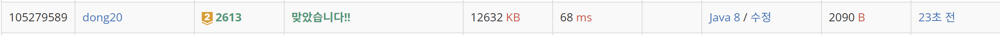

### BaekJoon Gold Ⅱ [숫자구슬](https://www.acmicpc.net/problem/2613) (Java)

> **문제 번호:** 2613  
> **날짜:** 2026년 11월 26일  
> **알고리즘:** 이분 탐색  
> **언어:** Java  
> **핵심 키워드:** 이분 탐색, 파라매트릭 서치

## 📌 문제 개요

- `N`개의 숫자 구슬이 일렬로 주어지며, 구슬의 순서를 바꿀 수 없다.
- `1 ≤ M ≤ N ≤ 300`이고, 각 구슬에 적힌 수는 `1` 이상 `100` 이하이다.
- 연속한 구슬들을 묶어 정확히 `M`개의 그룹을 만들며, 각 그룹에는 구슬이 하나 이상 포함되어야 한다.
- 그룹별 합의 최댓값을 최소화하고, 그 최솟값과 각 그룹에 속한 구슬 수를 왼쪽부터 출력한다.

---

## 💡 풀이 핵심 (Core Logic)

### 1. 그룹 합의 상한을 이분 탐색

구슬 값의 총합 `total`을 구하고, `binarySearch`에서 `0`부터 `total`까지 그룹 합의 상한을 탐색한다. 상한이 커질수록 필요한 그룹 수는 늘어나지 않으므로, `countGroup`의 결과가 `M` 이하이면 현재 상한을 `target`에 저장하고 더 작은 값을 탐색한다. `M`개를 초과하면 상한을 높여야 하므로 탐색 범위의 왼쪽 끝을 옮긴다.

### 2. 상한을 지키는 데 필요한 그룹 수 판정

`countGroup`은 왼쪽부터 구슬을 더하다가 다음 구슬을 넣으면 상한을 넘는 경우 새 그룹을 만든다. 각 그룹에 가능한 만큼 담아 불필요한 분할을 피하므로, 해당 상한에서 필요한 최소 그룹 수를 구할 수 있다. 구슬 하나의 값이 상한보다 크면 어떤 그룹에도 넣을 수 없으므로 즉시 `M + 1`을 반환한다.

필요한 그룹 수가 `M`보다 적더라도 기존 그룹을 더 나눌 수 있다. 구슬 값이 모두 양수라 나눈 그룹의 합은 상한을 넘지 않고, `M ≤ N`이므로 정확히 `M`개의 비어 있지 않은 그룹을 구성할 수 있다.

### 3. 남은 그룹 수를 고려해 구슬 개수 복원

`buildString`은 확정된 `target`으로 다시 배열을 순회하며 현재 그룹의 합과 구슬 개수를 관리한다. 다음 구슬을 더하면 상한을 넘거나, 아직 처리하지 않은 구슬 수 `arr.length - i`가 이후에 만들 그룹 수 `remain - 1`과 같아지면 현재 그룹의 개수를 출력하고 새 그룹을 시작한다.

두 번째 조건은 남은 그룹마다 구슬을 하나씩 배정할 수 있도록 현재 그룹을 미리 끝내기 위한 것이다. 마지막 그룹의 개수까지 추가하여 최소 상한과 정확히 `M`개의 그룹 크기를 출력한다.

### 시간 복잡도

이분 탐색의 각 판정에서 배열을 한 번 순회하므로 `O(N log(S + 1))`이다. 그룹 개수 복원은 `O(N)`이며 전체 시간 복잡도는 `O(N log(S + 1))`이다.

- `N`: 구슬의 개수
- `S`: 모든 구슬 값의 합

---

## 🧠 회고 및 결론

파라매트릭 서치는 아직 익숙하지 않다. 계속해서 점화식 실수를 하는 것 같아서 연습이 필요하다.

---

### 📂 소스 코드

[Solution.java](./Solution.java)

---

### 🖥️ 실행 결과

---
