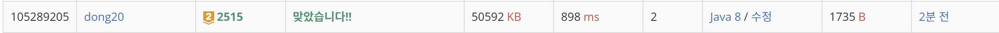

### BaekJoon Gold Ⅱ [전시장](https://www.acmicpc.net/problem/2515) (Java)

> **문제 번호:** 2515 <br>
> **날짜:** 2026년 11월 27일 <br>
> **알고리즘:** DP, 이분 탐색, 정렬 <br>
> **언어:** Java <br>
> **핵심 키워드:** DP, UpperBound, 정렬

## 📌 문제 개요

- 높이와 가격이 주어진 `N`개의 그림이 있으며, 그림의 폭은 모두 같다.
- 전시대의 폭이 그림의 폭과 같으므로 그림들을 서로 겹쳐 배치한다.
- 앞에서 보이는 부분의 세로 길이가 `S` 이상인 그림만 판매할 수 있다.
- `1 ≤ N ≤ 300,000`, `1 ≤ S ≤ H ≤ 20,000,000`, `1 ≤ C ≤ 1,000`이다.
- 그림을 배치하여 얻을 수 있는 판매가능 그림들의 가격 합의 최댓값을 구한다.

---

## 💡 풀이 핵심 (Core Logic)

### 1. 높이순 정렬로 함께 전시할 수 있는 구간 구성

`paints`에 높이와 가격을 저장하고 높이 오름차순으로 정렬한다. 높이가 같으면 가격 오름차순으로 정렬한다. 함께 판매할 그림들을 낮은 그림부터 앞쪽에 놓으면, 뒤에 놓인 그림은 바로 앞의 선택된 그림과의 높이 차이만큼 드러난다. 따라서 선택한 그림 사이의 높이 차이가 `S` 이상이어야 한다.

배열은 `N + 1`칸으로 만들고 입력은 처음 `N`칸에 저장한다. 남은 `(0, 0)` 원소는 모든 입력 높이가 양수이므로 정렬 후 인덱스 `0`에 위치한다. 실제 그림은 `1`부터 처리하며, 이전에 선택할 그림이 없는 경우 `dp[0]`의 초깃값 `0`을 사용한다. 코드에서 입력값 `S`는 지역 변수 `c`에 저장된다.

### 2. 이분 탐색으로 이전 선택의 마지막 범위 확인

`binarySearch`는 현재 그림 `i`에 대해 `paints[i][0] - paints[mid][0] ≥ c`인지 확인한다. 조건을 만족하면 더 큰 인덱스도 가능한지 확인하도록 왼쪽 경계를 옮기고, 만족하지 않으면 오른쪽 경계를 줄인다.

이는 높이가 `paints[i][0] - c`를 초과하는 첫 위치를 찾는 UpperBound 방식이다. 반환값 `left - 1`은 현재 그림과 함께 선택할 수 있는 마지막 인덱스이며, 해당 그림이 없으면 `0`이다. 높이가 정렬되어 있으므로 이 인덱스까지의 모든 그림은 현재 그림과 필요한 간격을 확보할 수 있다.

### 3. 현재 그림의 선택·제외 상태를 DP로 비교

`solve`는 정렬된 그림을 순서대로 처리하며 두 상태를 저장한다.

- `dp[i][0]`: `1..i` 구간에서 현재 그림 `i`를 선택할 때의 최대 가격 합
- `dp[i][1]`: `1..i` 구간에서 현재 그림 `i`를 제외할 때의 최대 가격 합

현재 그림을 선택하면 높이 차이 조건을 만족하는 구간까지만 이전 결과를 가져와야 하므로, 이분 탐색의 반환값을 `idx`라 할 때 다음과 같이 갱신한다.

```text
dp[i][0] = max(dp[idx][0], dp[idx][1]) + paints[i][1]
dp[i][1] = max(dp[i - 1][0], dp[i - 1][1])
```

현재 그림을 제외하면 앞의 `i - 1`개 그림에서 얻은 최적값을 그대로 유지한다. 모든 그림을 처리한 뒤 `max(dp[N][0], dp[N][1])`을 출력한다.

### 시간 복잡도

그림 정렬에 `O(N log N)`이 필요하다. 각 그림마다 `O(log N)`의 이분 탐색과 상수 시간의 DP 갱신을 수행하므로 전체 시간 복잡도는 `O(N log N)`이다. 그림 배열과 DP 배열의 공간 복잡도는 `O(N)`이다.

- `N`: 그림의 개수

---

## 🧠 회고 및 결론

선택, 비선택 DP 문제다. 배열의 값이 중복 된다는 점과 높이 차이 이상의 값을 빠르게 찾기 위해서 Upper Bound를 적용했다.

---

### 📂 소스 코드

[Solution.java](./Solution.java)

---

### 🖥️ 실행 결과



---
